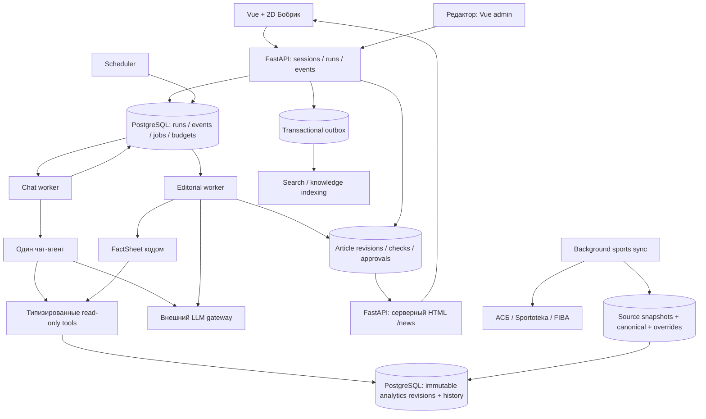

# Бобрик — ИИ-маскот БК ВГУ «Хищные Бобры»

**Статус:** план реализации и проверяемые контракты, версия 2.0.

**Проект:** отдельный сайт клуба, Vue 3 + FastAPI + PostgreSQL.

**Дата:** 16 ноября 2026.

**Документ не относится к бизнес-логике `request-analysis`; расположение файла историческое.**

Версия 2.0 заменяет версию 1.0 целиком. Замечания ревью встроены в основные разделы; старые противоречащие дополнения не действуют. Это спецификация будущей реализации, а не отчёт о готовых функциях или уже достигнутой скорости.

---

## 1. Цель и принятые решения

Добавить на сайт клуба доброго и отзывчивого Бобрика: публичный чат на русском, ответы по спортивным данным и всей сохранённой истории клуба, подготовку редакторских черновиков превью и разборов матчей.

### 1.1. Граница первого публичного запуска

| Решение | Обязательный результат |
|---|---|
| Маскот | Новый 2D Бобрик в клубном стиле с анимациями; 3D — отдельная поздняя возможность |
| Чат | Матчи, составы, таблицы, статистика, правила, контакты, вся доступная история клуба |
| Редакция | Превью и разборы после матчей; черновики доступны одновременно с чатом |
| Публикация | Только редактор; автопубликация выключена и не входит в приёмку MVP |
| Колонка | Следующая фаза; аналитика данных клуба без внешнего новостного ingestion |
| Денежный лимит LLM | По решению владельца пока unlimited: дневного/месячного потолка приложения нет; расходы учитываются |
| Инфраструктура | Собственный always-on сервер, один origin, внешний LLM API |
| Архитектура | Один модульный backend и PostgreSQL; отдельные процессы API, chat-worker, editorial-worker, scheduler |
| Импорт | Канонические игры, соперники, четверти, box score, pregame там, где доступны |
| Поиск | Все главы истории и турниры в первом запуске; FTS достаточно для базового пути, embeddings — по результатам evals |

Нельзя объявлять MVP готовым, выпустив только чат, только текущий сезон или только 2D-анимацию без редакторских черновиков. Внутренние этапы разработки допускаются, публичная приёмка общая.


### Краткая карта реализации

1. Подготовить canonical data и согласованные ревизии; сверить архив без дублей (§5–7).
2. Параллельно реализовать 2D-чат по всей истории и редакторские preview/recap drafts (§8–17).
3. Проверить reconnect, crash recovery, публикацию, мобильный UX и скорость при совместной нагрузке (§18–23).
4. Выпустить оба контура вместе после общей приёмки; денежный режим unlimited, публикация ручная.
5. После стабилизации добавлять колонку и отдельно 3D без изменения chat/domain API (§22).

Подробные schemas и параметры ниже задают проверяемые инварианты. Разрешён модульный код и общие helpers; таблицы/процессы не означают отдельные сетевые сервисы.

### 1.2. Главные принципы

1. Модель получает данные через типизированные инструменты и не выполняет SQL или административные команды.
2. Спортивные факты и расчёты формирует код. У утверждения есть субъект, показатель, период и источник.
3. Матчи, турнирные итоги и разные дисциплины не смешиваются; одна реальная встреча учитывается один раз.
4. Один ответ и один FactSheet используют одну завершённую `data_revision_id`.
5. История — «в сохранённом архиве», а не обещание полной летописи; отсутствие данных не означает отсутствие события.
6. Разрыв сети не запускает повторную генерацию; явная отмена останавливает работу.
7. Проверки и одобрение относятся к конкретной неизменяемой ревизии текста.
8. Импорт сохраняет редакторские overrides; чат, сайт и статьи читают одинаковые effective values.
9. Быстрый публичный путь не зависит от ответа Sportoteka, очереди статей или загрузки анимации.
10. Доступность, стоимость, восстановление и мобильное поведение — критерии MVP, а не дополнения после запуска.

---

## 2. Исходное состояние и подтверждённые ограничения

### 2.1. Что уже есть

- Vue 3 + Vite + TypeScript; публичная версия размещена на GitHub Pages.
- FastAPI + SQLAlchemy 2 + Alembic + Dishka; PostgreSQL/Supabase в production, SQLite локально.
- Главная, матчи, таблица, клуб, команды, игроки, правила, контакты.
- Админка игроков, матчей, турниров, залов, контента, достижений, таблиц, медиа, импорта, аудита и корзины.
- Роли `USER`, `EDITOR`, `ADMIN`; сессии, CSRF, аудит.
- Импорт АСБ/Sportoteka и адаптер FIBA 3×3.

Сверенные публичные исходники: frontend `bd21ea5c6de41b51cff17b112576f0bba0efd09d`, backend `cce2d9f8f203530cb67c7967af8bc78d79952d58`. Перед реализацией проверить актуальный HEAD и миграции; эти SHA не предписывают откат проекта.

### 2.2. Базовый объём архива

В исходном обследовании указаны 30 глав истории, 15 турнирных контекстов, 4 достижения, фотоархив; 237 архивных записей: **184 матча и 53 турнирных итога**; 42 призовых места (17–10–15). Архив АСБ: 166 игр, 150 завершённых; мужчины 69–17, девушки 34–30.

Это датированный контрольный ориентир для сверки миграции, не константы приложения и не системный промпт. Точные числа восстанавливаются запросом к текущему источнику с указанием `as_of` и scope. Каждый счётчик разделяет матчи и турнирные итоги.

В обследовании сезона 2026/27: мужчины победили ВГПУ 60:51 12 ноября; девушки уступили ВГАС 25:90 13 ноября; далее были указаны ВГТУ-2 20 ноября и ВГАС 27 ноября. Эти примеры нельзя выдавать как актуальное расписание без инструмента.

### 2.3. Наблюдение опубликованного сайта 16 ноября

На `/matches` запрос календаря во время проверки не вернул данные: три попытки примерно по 20 секунд, затем ошибка. Причина не локализована; это не доказательство, что сбой вызван именно сном бесплатного Render. Интерфейс одновременно показывает «Найдено: 0», хотя известно только, что загрузка не удалась.

До запуска Бобрика диагностировать upstream и убрать смешение empty/error. Пользователь должен видеть состояние недоступности сразу после установленного deadline и иметь безопасный явный retry. Сервер чата не должен повторять минутное ожидание текущего календарного клиента.

На mobile 390×844 уже существует закреплённая нижняя навигация высотой около 70 px. Положение кнопки маскота рассчитывается относительно неё (§12, §17). Прямой URL GitHub Pages сейчас проходит через SPA 404 fallback; новый own-origin deployment должен обслуживать маршруты без этого обхода.

### 2.4. Редакционный язык

Существующие правила `clubCopy` переносятся в общий серверный валидатор: «команда девушек», «сборная девушек», «5×5», «3×3», «фиджитал». Источники не переписываются задним числом; даты и счета не выдумываются. Общие правила имеют версию и одинаковые fixture-тесты на сервере и во frontend.

---

## 3. Что необходимо добавить

1. **Данные:** канонические игры и внешние идентификаторы; явное отделение турнирных итогов; связи команды, соревнования, игрока и стороны клуба; четверти и box score; сохранение источника и редакторских overrides.
2. **Согласованная аналитика:** неизменяемые опубликованные read-model revisions; H2H, форма и статистика считаются в одном scope и по одной ревизии.
3. **Контент:** отдельные articles/revisions/sources/checks/approvals вместо использования статических `content_blocks` как новостей.
4. **Надёжный чат:** анонимная сессия с владением, идемпотентный run, очередь исполнения, журнал событий, reconnect и отдельная отмена.
5. **Редакционный worker:** восстанавливаемые задачи с lease/fencing, ограничениями бюджета и повторов, FactSheet и ручной публикацией.
6. **Интерфейс:** 2D-player независимо от чата, мобильная панель, контекст страницы, понятные пустые и ошибочные состояния.
7. **Эксплуатация:** always-on инфраструктура, capability-проверка gateway, общий rate limit, SLO и recovery-тесты, backups/restore.

Sportoteka предоставляет календарь и для части игр fullScore, box score и pregame. Конкретные endpoint, полнота ответа, значения Forfeit и область сезонной статистики подтверждаются в фазе 0 на сохранённых fixtures. HTTP 404 на box score означает отсутствие этих данных, а не отсутствие матча.

---

## 4. Целевая архитектура



### 4.1. Границы исполнения

Один backend-репозиторий, общие доменные сервисы, схемы и миграции. Процессы развёртываются отдельно: API обслуживает HTTP/SSE и короткие транзакции; chat-worker выполняет чат-runs; editorial-worker — статьи, outbox и индексирование с отдельными лимитами; scheduler планирует синхронизацию и задания. Это модульный монолит, не набор сетевых микросервисов.

Долгая генерация не запускается через FastAPI BackgroundTasks и не принадлежит жизненному циклу HTTP-запроса. Общие ограничения, leases и состояние circuit breaker хранятся в PostgreSQL. Память процесса не является источником истины для run, бюджета или rate limit.

В публичном tool layer **нет вызовов внешних спортивных API и write-методов**. Внешние ответы получает только background sync. API и workers используют ограниченные роли БД; LLM не получает DB credentials.


Editorial-worker имеет независимые PG queues и async lanes: article_generation concurrency=1, sports_sync concurrency=1, short_outbox concurrency=1 с приоритетом коротких outbox tasks. Общая квота editorial LLM остаётся 1, sync и outbox модель не вызывают. Долгий HTTP sync не держит article/outbox semaphore; CPU-heavy indexing ограничен порциями/CPU quota и не блокирует event loop/API. Термин «knowledge handler» обозначает outbox lane в этом процессе, не дополнительный knowledge-worker. Scheduler только enqueue, а не HTTP или генерация. Все lanes используют общие lease/fencing правила; их health/queue age видны отдельно.

### 4.2. Публичные статьи и SEO

В MVP `/news` и `/news/{slug}` обслуживает FastAPI + Jinja2 через тот же article service, что JSON API. Исходный HTML содержит текст, canonical, OG и JSON-LD. Общее оформление использует клубные CSS/brand assets. Между Vue SPA и новостями — обычные ссылки `<a>`; отдельный Nuxt/SSR frontend не требуется.

Nginx направляет `/api/` и `/news` в API, статику и остальные маршруты — во Vue SPA. Draft/preview не доступны по публичному slug. Каждый публичный запрос проверяет `published_revision_id` и текущую видимость; непубличная статья возвращает 404. Кэш публичного HTML статей в MVP выключен, чтобы unpublish не зависел от асинхронной сборки или CDN purge. Позже кэш допускается только с проверяемой инвалидацией.

Публикация и audit фиксируются одной транзакцией; outbox обновляет поиск и sitemap. Ошибка индексатора не отменяет публикацию и не даёт права выдавать снятую статью из поиска или RAG: visibility проверяется синхронно (§14).

### 4.3. Минимальная сложность

PostgreSQL достаточен для очередей, сессий, rate limit, бюджетов и полнотекстового поиска. Redis/RabbitMQ, pgvector, reranker и CrewAI не являются зависимостями базового запуска. Их подключают только при измеримой пользе без изменения доменных контрактов. Модель не нужна для подсчёта очков и формирования FactSheet.

---

## 5. Данные и фоновая синхронизация

### 5.1. Граница контура

Scheduler только ставит sports-sync jobs; HTTP-запросы к Sportoteka/АСБ и FIBA выполняет их обработчик в `editorial-worker` с отдельной sync-квотой. Публичный API, чат и редакционные flow не обращаются к провайдерам. Они читают только локальные канонические данные и готовую аналитическую ревизию PostgreSQL.

Основной путь данных один:

```text
provider response
  -> immutable source_snapshot
  -> provider identity / canonical projection
  -> field override
  -> effective projection
  -> immutable analytics revision
```

Ошибка или неполный ответ провайдера не очищает последние подтверждённые значения. Любая проекция хранит ссылку на исходный снимок; ручная правка хранится отдельно и импортом не перезаписывается.

### 5.2. Каноническая игра

`sport_games` описывает реальную игру, а не запись конкретного источника:

```text
sport_games
  id UUID PK
  team_id UUID FK teams NOT NULL
  competition_id UUID FK competitions NOT NULL
  venue_id UUID FK venues NULL
  opponent_id UUID FK opponents NOT NULL
  club_side VARCHAR(8) NOT NULL       -- home | away
  discipline VARCHAR(16) NOT NULL     -- 5x5 | 3x3 | phygital
  season VARCHAR(32) NOT NULL
  stage_name VARCHAR(200) NULL
  starts_at TIMESTAMPTZ NULL
  event_date DATE NULL
  date_precision VARCHAR(16) NOT NULL -- time | day | month | year
  home_team_name VARCHAR(200) NOT NULL
  away_team_name VARCHAR(200) NOT NULL
  home_score INT NULL
  away_score INT NULL
  status VARCHAR(24) NOT NULL
  result_type VARCHAR(16) NOT NULL    -- normal | overtime | forfeit | technical | unknown
  club_result VARCHAR(16) NULL        -- win | loss | draw | void
  canonical_snapshot_id UUID FK source_snapshots NULL
  created_at, updated_at
```

Ограничения БД: счёт либо полностью `NULL`, либо обе части неотрицательны; `club_side` определяет клубный и сопернический счёт; `club_result` допустим только для завершённой официально опубликованной игры. `unpublished`, `cancelled` и `void` не входят в W/L. Forfeit/technical входят только с официальным исходом, сохранённым в `club_result`; вычислять его из условного технического счёта нельзя.

Текущие `matches` получают уникальный nullable `sport_game_id` и остаются CMS-представлением календаря. `archive_results` получают `record_kind = game | tournament_result` и nullable `sport_game_id`; только `record_kind=game` может ссылаться на `sport_games`. Турнирное место без соперника и игрового счёта никогда не становится игрой.

### 5.3. Идентификаторы провайдеров и соперники

Внешние идентификаторы не хранятся как identity канонической строки. Для каждой сущности используются таблицы `sport_game_provider_ids`, `opponent_provider_ids`, `player_provider_ids` и `competition_provider_ids` со столбцами:

```text
canonical_id UUID FK
provider VARCHAR(32)
namespace VARCHAR(200)              -- tag/competition namespace
external_id VARCHAR(200)
first_seen_snapshot_id UUID FK
last_seen_snapshot_id UUID FK
UNIQUE(provider, namespace, external_id)
```

`opponents` хранит каноническое название, короткое название, город и активность. `opponent_aliases` содержит `opponent_id`, исходный и нормализованный alias, provider/namespace и интервал действия. Нормализация ограничена casefold, `ё -> е`, пунктуацией и пробелами. Нечёткое сходство создаёт только запись `identity_review`; автоматического merge нет. «ВГТУ»/«ВГТУ-2» и «ВГАС»/«ВГАС-Ф» по умолчанию различны.

Merge соперников выполняется транзакционно: provider identities, aliases и game FK переносятся на survivor; старый opponent становится redirect/tombstone; до commit ADMIN видит все затрагиваемые игры. Audit обязателен.

### 5.4. Снимки, overrides и effective values

Каждый HTTP-ответ сохраняется как immutable `source_snapshots`: provider, endpoint kind, namespace, request identity без секретов, source URL, fetched_at, HTTP status, completeness, payload SHA-256, raw JSON либо object-storage key. Одинаковый payload дедуплицируется по hash, но каждый sync run сохраняет факт проверки.

`entity_field_sources` связывает каждое каноническое поле с `snapshot_id`; поэтому дата из calendar и статистика из box score сохраняют разное происхождение. `entity_field_overrides` содержит entity type/id, field name, JSON value, reason, actor, created_at и revoked_at. Редактор меняет import-owned поле только созданием/отзывом override. `effective_sport_games` и аналогичные effective views выбирают активный override поверх последней подтверждённой canonical projection. Effective views являются входом builder. Публичные спортивные API сайта и инструменты читают одну опубликованную analytics revision: до её активации оба сохраняют прежние значения. Админка может показать ещё не активированную правку с явной меткой. Cutover существующих календарных/статистических API входит в миграцию.

### 5.5. Периоды и статистика

`game_period_scores` хранит `(sport_game_id, period_index)`; `period_index=1..4`, овертаймы продолжают 5, 6 и далее. `period_kind=q|ot`, home/away score обязательны.

`game_team_stats` хранит одну строку на `(sport_game_id, side)`, где side — `home|away`. `game_player_stats` хранит provider row identity, `sport_game_id`, side и статистику; для игрока клуба обязателен `player_id FK players`. Неидентифицированная строка клуба попадает в `identity_review` и не входит в player analytics. Статистика соперника может храниться без внутренней карточки игрока, но не смешивается с клубными игроками.

Сезонные snapshots (`roster`, `teams/stats`, `players-stats`, standings) обязаны иметь `scope_kind = competition | all_competitions`, `competition_id` при competition scope, season, provider namespace, fetched_at и source snapshot. Scope нельзя угадывать по числу игр. Provider `pregame` сохраняется как источник на конкретный момент, но его H2H/form не заменяют расчёт по каноническим играм.

### 5.6. Импорт и идемпотентность

Фоновая синхронизация использует сохранённые endpoints:

```text
teams/games; games/game; games/pregame; teams/roster; teams/stats;
comps/standings; comps/players-stats; comps/best-players
```

Каждый `sync_run` имеет provider, namespace, target, started_at, finished_at, status и snapshot set. На один target действует advisory lock. Применение одного snapshot set выполняется одной транзакцией: upsert identities, canonical rows и полная замена дочерних периодов/stats, только если ответ помечен complete. Повтор с тем же snapshot set даёт тот же результат. 404 необязательного box score/play-by-play отмечает capability missing и не удаляет игру.

Удаление у провайдера сначала помечает identity как `missing_since`; canonical запись скрывается только после двух успешных полных sync подряд либо ручного решения. Частичный/ошибочный sync не меняет missing state. После commit создаётся запрос на новую analytics revision через transactional outbox.

### 5.7. Backfill без дублей

1. Сначала классифицировать каждую archive row как `game` или `tournament_result`.
2. Связать записи по точному provider identity, если он уже есть.
3. Для оставшихся создать deterministic candidates по team, discipline, competition, opponent alias, official date и score.
4. Автоматически объединить только единственный exact candidate; при month/year precision, конфликте счёта, нескольких кандидатах или fuzzy name создать `identity_review`.
5. Не создавать `sport_game` для unresolved row. Она остаётся доступной в legacy archive и не входит в H2H/form.
6. После ручного решения повторно прогнать backfill идемпотентно, сравнить counts и проверить 10 известных пар H2H.
7. Построить первую analytics revision и только после проверок атомарно сделать её active.

### 5.8. Приватность

Хранятся только уже публичные спортивные данные: имя, номер, позиция, публичные рост/вес/фото и спортивная статистика. Даты рождения, контакты, документы, адреса и зарплаты не импортируются.

### 5.9. Детализация статистических полей и неизвестных значений

Team/player rows сохраняют points; fg2m/fg2a, fg3m/fg3a, ftm/fta; offensive/defensive rebounds, assists, turnovers, steals, blocks, fouls; seconds, plus_minus, efficiency при наличии. Player row дополнительно хранит started. Pregame snapshot содержит captured_at, исходный scope, h2h/team stats/last games и snapshot_id. Отсутствующие значения NULL, а не 0; проценты вычисляются из сумм makes/attempts.

Canonical row также имеет neutral_venue BOOLEAN NULL, official_result_published BOOLEAN NOT NULL и подтверждённый source status. Для старого матча с неизвестным competition создаётся явный контекст «соревнование не уточнено» с собственным FK и caveat; неизвестного соперника/сторону нельзя заполнять фиктивным подтверждённым значением. Такая legacy row остаётся историческим свидетельством, но не включается в неподтверждённый H2H/form. Базовый корпус истории при этом не сокращается.

Приоритет источников фиксируется по domain field: официальный calendar/result — дата и результат; box score — периоды и игровые показатели; клубный подтверждённый архив — исторические факты. Конфликт двух официальных значений не разрешается временем fetch без проверки: старая подтверждённая проекция сохраняется, создаётся identity/data review. Наличие игры у источника не отменяет отдельный редакторский override.

Полный набор query-параметров Sportoteka (teamId, tag, season, id, lang, pagination) хранится в adapter fixtures, а не зашивается в scheduler. Проверить teams/games, games/game, games/pregame, teams/roster, teams/stats, comps/standings, comps/players-stats и comps/best-players. Play-by-play — позднее дополнение, не условие загрузки матча.

---

## 6. Аналитический слой и согласованность

### 6.1. Immutable analytics revision

Аналитика не строится поверх меняющихся operational tables во время ответа. Каждая пересборка создаёт `analytics_revisions`:

```text
analytics_revisions
  id UUID PK
  status VARCHAR(16)        -- building | ready
  source_cutoff_at TIMESTAMPTZ
  source_set_hash VARCHAR(64)
  created_at, ready_at

analytics_active_pointer
  singleton BOOLEAN PK
  revision_id UUID FK analytics_revisions
  updated_at
```

Каждая строка read model содержит `revision_id`; первичные/уникальные ключи включают его. Worker создаёт новую revision в `building`, заполняет все marts, проверяет counts/invariants и переводит её в `ready`. В той же короткой транзакции он меняет active pointer. Читатель видит целиком старую или целиком новую ревизию, но не смесь.

Неудачная сборка не меняет pointer. Повтор для того же `source_set_hash` переиспользует готовую revision. Старые ревизии удаляются только когда они не active и на них нет lease от chat run, FactSheet/editorial job или audit retention.

### 6.2. Pinning на один запуск

В начале chat run или редакционного job API фиксирует:

```text
data_revision_id = analytics_active_pointer.revision_id
knowledge_revision_id = knowledge_active_pointer.revision_id
```

При enqueue API/scheduler одной транзакцией читает оба ready active pointers, сохраняет IDs в run/job и создаёт owner-typed revision lease до commit. Для chat owner_type=chat_run, для редакции owner_type=editorial_job. Нельзя создавать job без lease или выбирать свежие pointers заново при claim. Оба ID сохраняются в run/job и во FactSheet. Все tool calls этого запуска получают IDs из server context; LLM и клиент не могут их подменить. `revision_leases(owner_type, owner_id, data_revision_id, knowledge_revision_id, expires_at)` продлевается до завершения или timeout; очистка обеих projection проверяет эту таблицу. Поэтому один ответ и одна статья не смешивают данные до и после sync.

### 6.3. Read models

Минимальный набор:

```text
analytics.game_effective
analytics.team_form
analytics.h2h
analytics.player_game_log
analytics.player_form
analytics.standings
analytics.match_context
```

`game_effective` материализует effective values и canonical IDs. `match_context` содержит матч, турнир/стадию, venue, standings, последние игры, H2H, roster/player stats, sample sizes, caveats и provenance IDs. Исторические пассажи не копируются в sports mart: они запрашиваются в knowledge revision и добавляются в FactSheet с отдельными citations.

### 6.4. Детерминированные определения

| Метрика | Правило |
|---|---|
| Результат | только official finished game с `club_result=win|loss|draw` |
| Разница | club score минус opponent score с учётом `club_side` |
| Форма | последние N eligible games одного team и discipline |
| Серия | подряд win/loss; draw/void завершает серию |
| H2H | canonical opponent, team и discipline; all-time и последние 5 |
| Home/away | по `club_side`, neutral venue отдельным флагом при наличии данных |
| Четверти | только сохранённые official period rows |
| Player rates | суммы makes/attempts; процент NULL при нулевом denominator |

Для form/streak подходят только `date_precision=time|day`. Month/year records участвуют в all-time H2H totals, но не в «последних N», streak и biggest-by-recency; ответ получает caveat. Порядок — `COALESCE(starts_at,event_date)`, затем stable `sport_game_id`. 5×5, 3×3 и phygital никогда не агрегируются вместе.

Forfeit/technical учитывается по сохранённому official `club_result`, а не по inferred score. Игра без опубликованного счёта не входит в averages или W/L. Season и competition scope передаются явно; `all_competitions` не выдаётся за league form.

### 6.5. Достаточность данных

- `games_played < 3`: не использовать «лидер сезона»; писать точный sample size.
- Нет H2H: «в сохранённом архиве встреча не найдена».
- Нет periods: не делать выводов о четвертях.
- Нет box score: не называть лидера по rebounds/assists.
- Нет подтверждённых injury/news data: не утверждать отсутствие игрока или внешние новости.
- Неполный archive coverage, unresolved identity или imprecise date добавляются в `caveats`.

Advanced metrics включаются по metric capability, а не одним общим флагом: eFG% и TS% допустимы из полного box score; possession-based ORtg/DRtg/pace — только при документированной формуле и достаточных входах. Каждое значение содержит method/version.

### 6.6. Проверки перед activation

Builder обязан проверить: отсутствие duplicate canonical games в revision; FK integrity; ровно одну club side; score/period consistency; discipline isolation; H2H symmetry; player totals не меньше нуля; standings scope; counts против предыдущей revision с порогами. Ручные golden checks: минимум 10 пар H2H, 10 игр с четвертями и текущие standings обеих команд.

Нарушение оставляет revision в `building` и создаёт alert; active pointer не меняется. `get_data_status` показывает active revision, source cutoff, последний успешный sync, unresolved identity count и последнюю ошибку builder.

---

## 7. Контракты инструментов

### 7.1. Контекст выполнения

Tool layer — единственная поверхность данных для chat-agent и editorial flows. Инструменты читают PostgreSQL read models и knowledge index; сетевых вызовов к Sportoteka/АСБ/FIBA в tool layer нет.

При старте run сервер создаёт `run_context`:

```json
{
  "run_id": "uuid",
  "data_revision_id": "uuid",
  "knowledge_revision_id": "uuid",
  "locale": "ru-RU"
}
```

IDs берутся из active pointers и не принимаются из пользовательского сообщения или tool arguments. Editorial FactSheet сохраняет тот же context. Параллельные вызовы внутри run читают одну пару ревизий.

### 7.2. Общий ответ и provenance

Успешный инструмент возвращает:

```json
{
  "data": {},
  "meta": {
    "data_revision_id": "uuid",
    "knowledge_revision_id": "uuid",
    "as_of": "2026-11-16T10:00:00Z",
    "sample_size": 4,
    "caveats": [],
    "provenance": [
      {
        "source_type": "sport_game",
        "source_id": "uuid",
        "snapshot_id": "uuid",
        "label": "АСБ",
        "url": "https://...",
        "fetched_at": "2026-11-16T09:55:00Z"
      }
    ]
  }
}
```

`provenance` — массив, потому что H2H, standings и FactSheet объединяют несколько источников. URL допускается только из серверной allowlist. Caveats обязательны при неполном archive, малой выборке, unresolved identity, imprecise dates или отсутствующей детализации.

Ошибка имеет `code`, безопасный `message`, `retryable` и те же revision IDs. Допустимые codes: `not_found`, `ambiguous_entity`, `insufficient_data`, `revision_expired`, `temporarily_unavailable`, `invalid_arguments`. Raw provider/SQL errors наружу не выходят.

### 7.3. Публичные read tools

| Инструмент | Вход | Результат |
|---|---|---|
| `get_next_match` | `team_id`, `discipline` | ближайшая eligible game |
| `list_matches` | filters, cursor, limit | матчи одной revision |
| `get_match` | `sport_game_id` | матч, periods, box score |
| `get_head_to_head` | `team_id`, `opponent_id`, `discipline`, `limit?` | H2H |
| `get_team_form` | `team_id`, `discipline`, `last_n`, `competition_id?` | форма |
| `get_standings` | `team_id`, `competition_id`, `scope` | таблица/плей-офф |
| `get_roster` | `team_id`, `season`, `scope` | состав и sample-aware stats |
| `get_player_stats` | `player_id`, `season`, `scope` | aggregate stats |
| `get_player_game_log` | `player_id`, `last_n`, `competition_id?` | игры игрока |
| `search_club_history` | query, filters, limit | passages и citations |
| `get_club_facts` | topic? | проверенные факты клуба |
| `get_honours` | team_id? | tournament results, не games |
| `get_tournaments` | filters? | турнирные контексты |
| `get_venues` | city? | залы |
| `get_contacts` | — | опубликованные контакты |
| `get_rules` | topic? | опубликованные правила |
| `get_data_status` | — | revision/freshness/coverage |

Name resolution выполняется отдельным deterministic resolver. Если нормализованному имени соответствуют несколько opponents/players, tool возвращает `ambiguous_entity` с коротким списком; LLM не выбирает fuzzy candidate самостоятельно.

### 7.4. Редакционные tools

| Инструмент | Вход | Результат |
|---|---|---|
| `build_match_fact_sheet` | `sport_game_id` | immutable FactSheet с revision IDs |
| `build_weekly_context` | week_start, team_id? | контекст недели |
| `search_history_for_article` | query, filters | passages с citations |
| `save_article_draft` | validated ArticleDraft + FactSheet ID | draft revision |

`publish_article`, `approve` и `unpublish` не являются LLM tools. Draft сохраняет FactSheet ID, data/knowledge revision IDs и exact provenance. Черновики не входят в knowledge search и не видны публичному чату. Публичный чат по всей сохранённой истории и генерация черновиков могут работать одновременно, потому что каждый run закреплён за собственной парой immutable revisions.

### 7.5. Кэширование

Ключ кэша:

```text
tool_name + tool_contract_version + canonical_json(arguments)
          + data_revision_id + knowledge_revision_id + locale + visibility_scope
```

Кэш хранит только успешный компактный ответ вместе с provenance/caveats. Переход active pointer не требует массового purge: новая revision автоматически даёт новый ключ. Для knowledge tools перед отдачей кэша всё равно выполняется синхронная visibility/version проверка article citations; отозванная статья удаляется из результата. `revision_expired` никогда не кэшируется.

### 7.6. Политика вызовов

- Chat: до 4 tools, timeout одного локального tool 2 секунды, общий budget tools 4 секунды внутри общего deadline. Цель нормального SQL/FTS-чтения значительно ниже; timeout не является целевой задержкой.
- Независимые tools выполняются параллельно.
- JSON ограничен нужными полями, pagination обязательна для списков.
- Chat tools read-only; editorial write surface ограничен `save_article_draft`.
- Tool output считается данными, не инструкциями.
- Agent обязан отразить caveats и не расширять утверждение дальше возвращённых данных.
- Citation в финальном ответе должна ссылаться на конкретный provenance item.

Контрактные тесты фиксируют JSON Schema каждого tool, revision pinning, deterministic cache key, ambiguity behavior и запрет provider HTTP в chat/editorial tool process.

---

## 8. API-контракты

Все маршруты находятся под `/api/v1`. Публичный клиент и API работают с одного origin. API-процесс не выполняет LLM-вызовы в ASGI background tasks: он создаёт durable run в PostgreSQL, а исполнение забирает `chat-worker`.

### 8.1. Анонимная сессия маскота

```http
POST /api/v1/mascot/sessions
```

Ответ создаёт:

- opaque `mascot_session` в `HttpOnly; Secure; SameSite=Lax` cookie;
- отдельный читаемый клиентом CSRF token;
- `session_id`, `expires_at` и начальные лимиты в JSON.

В БД хранится только хеш opaque token. `session_id` сам по себе не даёт доступа. Каждый изменяющий запрос проверяет cookie, CSRF и владение сессией. История одной анонимной сессии не доступна другой. Ротация токена не меняет `session_id`; истечение и отзыв закрывают создание новых run и чтение их событий.

### 8.2. Создание chat run

```http
POST /api/v1/mascot/chat/runs
Content-Type: application/json
X-CSRF-Token: ...
```

```json
{
  "client_request_id": "018f...",
  "session_id": "uuid",
  "message": "Когда следующий матч и как мы играли с ними раньше?",
  "context": {
    "page": "match",
    "match_id": "existing-cms-match-uuid",
    "sport_game_id": "canonical-game-uuid-or-null",
    "team": "men"
  }
}
```

Контекст страницы валидируется по allowlisted schema; сервер разрешает CMS match_id в canonical sport_game_id и проверяет принадлежность команды/дисциплины. Клиентский текст/ID не создаёт фактов. `client_request_id` обязателен и стабилен при сетевом retry клиента. Сервер вычисляет хеш нормализованного payload и обеспечивает `UNIQUE(session_id, client_request_id)`:

- первый запрос создаёт `chat_run` в `queued` и возвращает `202`;
- повтор с тем же payload возвращает тот же `run_id` и текущий статус;
- повтор с другим payload возвращает `409 idempotency_payload_mismatch`;
- если в сессии уже есть активный run, сервер возвращает `409 active_run_exists` с его `run_id`.

```json
{
  "run_id": "uuid",
  "session_id": "uuid",
  "status": "queued",
  "events_url": "/api/v1/mascot/chat/runs/uuid/events"
}
```

Ограничение «один активный run на сессию» обеспечивается partial unique index для `queued|running|cancelling`, а не только проверкой приложения.

### 8.3. SSE событий run

Единый ProgressStage enum: queued | reading_data | thinking | validating. Он используется API schema, frontend и tests без локальных aliases. Это status.stage, а не состояние chat_runs. Единственное содержательное событие MVP — answer; завершение — done/error/cancelled. Для validated answer нет дополнительного потокового chunk-протокола.

```http
GET /api/v1/mascot/chat/runs/{run_id}/events?after_seq=17
Accept: text/event-stream
```

Cookie должна владеть сессией run. `after_seq` — последний полностью обработанный номер; `Last-Event-ID` принимается как эквивалент. Если заданы оба, значения должны совпадать. Каждый сохранённый event имеет монотонный `seq`, а SSE `id` равен `seq`.

```text
id: 1
event: status
data: {"stage":"queued"}

id: 2
event: status
data: {"stage":"reading_data"}

id: 3
event: tool
data: {"name":"get_next_match","status":"finished"}

id: 4
event: answer
data: {"text":"...","citations":[...],"claims_version":"claims-v1"}

id: 5
event: done
data: {"run_id":"...","message_id":"...","usage":{"input_tokens":3200,"output_tokens":410}}
```

MVP не показывает непроверенные model tokens. Модельный ответ полностью буферизуется, получает структурированные claims/citations, детерминированную проверку чисел и сущностей и выходную модерацию. Только после этого worker атомарно сохраняет `answer`, затем может отдать его подписчикам. Одно событие `answer` предпочтительнее имитации печати. Позднее разрешён sentence streaming только с отдельной доказанной схемой проверки до показа каждой части.

События `status` и `tool` доступны сразу. Единственное событие `answer` и последующее `done` записываются атомарно с assistant message и состоянием `completed`; `error` или `cancelled` аналогично фиксируются со своим terminal status. Ответ до commit не отправляется. Worker группирует частые события не дольше 100 мс или 1 КиБ; flush в БД происходит до передачи в SSE. Batching разрешён только ДО назначения seq и сохранения; replay возвращает ровно те же persisted events с прежними id/type/payload, без перенумерации или объединения. После done/error/cancelled SSE закрывается.

API шлёт SSE heartbeat-комментарий каждые 15 секунд, пока подписка открыта. Heartbeat не является persisted event и не меняет `seq`.

### 8.4. Разрыв, повторное подключение и восстановление

Перед первичной доставкой answer и его replay сервер проверяет сохранённые dependency refs на отзыв публикации/версии источника. Если обязательный источник отозван, старый answer не отдаётся и не переписывается: до открытия SSE возвращается 409 source_revoked; при уже открытой подписке транспорт закрывается без старого answer, следующий reconnect получает тот же HTTP 409. Journal и terminal state завершённого run не переписываются. Клиент показывает «Источник обновлён, запросите новый ответ»; новый run создаётся только явным действием пользователя. Уже увиденный текст на клиенте помечается устаревшим, это не обещание отзыва ранее прочитанной информации. Byte-for-byte replay действует для разрешённых persisted events и никогда не обходит visibility gate.

Разрыв SSE не отменяет run. Клиент повторно подключается 2–3 раза с backoff и `after_seq`. До первого подключения `run_id` уже известен из POST, поэтому повторное создание run не требуется.

Chat-worker учитывает живых подписчиков через короткие subscriber leases. Если подписчиков нет, начинается grace period до 20 секунд, но он не продлевает общий deadline run: общий hard deadline остаётся 20 секунд от принятия run API, включая queue wait. Возврат подписчика во время grace отменяет мягкую остановку.

Поведение после сбоя провайдера или worker:

- до сохранённого `answer` разрешена одна bounded retry того же шага в пределах общего deadline и бюджета;
- после сохранённого `answer` он всегда replayed byte-for-byte и не генерируется заново;
- если worker упал после принятия вызова провайдером, но до durable результата, исход считается unknown: повтор допустим только с подтверждённой provider idempotency/retrieval; иначе run становится interrupted без скрытого нового платного вызова;
- если когда-либо был показан содержательный ответ, silent regeneration запрещена;
- исчерпавший deadline run завершается `failed` или `interrupted` с сохранённой диагностикой, пользователь явно создаёт новый run.

### 8.5. Явная отмена

```http
POST /api/v1/mascot/chat/runs/{run_id}/cancel
X-CSRF-Token: ...
```

Отмена проверяет владение, идемпотентна и переводит run в `cancelling`. Worker наблюдает cancel flag, отменяет текущий provider request/tool, сохраняет `cancelled` event и не начинает следующие платные вызовы. Уже понесённая или неопределённая стоимость остаётся в budget accounting; отмена HTTP не обещает возврат оплаты провайдером. Закрытие вкладки или fetch не считается отменой.

### 8.6. Терминальные состояния и ошибки

`chat_runs.status` принимает `queued`, `running`, `completed`, `failed`, `interrupted`, `cancelling`, `cancelled`. Терминальное состояние и последний `seq` сохраняются в одной транзакции с терминальным event.

```text
event: error
data: {"code":"llm_unavailable","message":"Бобрик временно недоступен","retryable":true}
```

Публичная ошибка не содержит prompt, stack trace, ключ провайдера или сырые tool payload. `retryable=true` предлагает пользователю новый явный запуск, а не автоматическое создание второго ответа.

### 8.7. Фидбек

```http
POST /api/v1/mascot/feedback
X-CSRF-Token: ...
```

```json
{"message_id":"uuid","rating":"up","comment":"Полезно"}
```

Сессия должна владеть сообщением. Один пользовательский feedback на сообщение обновляется идемпотентно.

### 8.8. Статьи и редакция

```http
GET  /api/v1/articles?kind=preview&team=men&season=2026-2027&page=1&page_size=12
GET  /api/v1/articles/{slug}
GET  /api/v1/articles/{slug}/related

GET   /api/v1/admin/articles?status=ready_for_review
GET   /api/v1/admin/articles/{id}
PATCH /api/v1/admin/articles/{id}
POST  /api/v1/admin/articles/{id}/approve
POST  /api/v1/admin/articles/{id}/reject
POST  /api/v1/admin/articles/{id}/publish
POST  /api/v1/admin/articles/{id}/unpublish
POST  /api/v1/admin/articles/{id}/regenerate
GET   /api/v1/admin/editorial/jobs
POST  /api/v1/admin/editorial/jobs/{id}/retry
POST  /api/v1/admin/editorial/jobs/{id}/cancel
```

Публичная выдача возвращает только текущую опубликованную ревизию. Административные изменения требуют существующую пользовательскую сессию, CSRF и нужную роль; идентификатор ресурса в URL не заменяет проверку владения и полномочий. Mutating endpoints принимают `Idempotency-Key`; редактирование передаёт ожидаемую optimistic `version`.

Публичные HTML-маршруты `/news` и `/news/{slug}` рендерит FastAPI + Jinja2 через тот же article service, что JSON API. Каждый SSR request live-проверяет `published_revision_id`; draft, unpublished и неизвестный slug возвращают `404` и не раскрывают метаданные черновика. Public SSR cache в MVP выключен, поэтому publish/unpublish видны сразу и не зависят от outbox. Навигация между Vue SPA и SSR-страницами использует обычные `<a>`.

### 8.9. Транспортные заголовки

Для SSE:

- `Cache-Control: no-cache, no-transform`;
- `X-Accel-Buffering: no`;
- proxy buffering и compression выключены;
- proxy timeout больше hard deadline с запасом;
- response не проходит через обычный JSON `apiRequest`; frontend использует отдельный `fetch` + `ReadableStream` транспорт.

### 8.10. Остальные обязательные endpoints

`GET /api/v1/mascot/chat/runs/{run_id}` возвращает status и last_seq с проверкой владения. `DELETE /api/v1/mascot/sessions/current` очищает историю/отзывает текущую сессию и отменяет её runs. `GET /api/v1/search?q=...&type=all|match|player|article|history&page=1` использует FTS без LLM.

Редакторские routes включают `POST /api/v1/admin/editorial/generate`, `GET /api/v1/admin/editorial/jobs/{id}`, `POST /api/v1/admin/articles/{id}/check`, а также approved/revision metadata. ADMIN-only `GET/PATCH /api/v1/admin/mascot/config` и `GET /api/v1/admin/mascot/usage` отделены от контентных полномочий.

Имена article product во всех слоях — match_preview и match_recap; public kind preview/recap допускается как документированный filter alias. Publish/approve принимают revision_id, content_hash, check_run_id и expected optimistic_version. Kill switch публикации проверяется в publish transaction, а не только в UI.

---

## 9. Модель статей, чата и надёжных заданий

### 9.1. Stable article и immutable revisions

`article` — стабильная редакционная сущность продукта в заданной области. Для превью/разбора `scope_key` содержит canonical match id, для колонки — week/issue key.

```text
articles
  id UUID PK
  product_key VARCHAR(64) NOT NULL
  scope_key VARCHAR(200) NOT NULL
  slug VARCHAR(200) UNIQUE NOT NULL
  draft_head_revision_id UUID NULL
  approved_revision_id UUID NULL
  published_revision_id UUID NULL
  is_deleted BOOLEAN NOT NULL DEFAULT false
  published_at TIMESTAMPTZ NULL
  optimistic_version INT NOT NULL
  created_at, updated_at
  UNIQUE(product_key, scope_key)
```

Workflow draft/checking/ready_for_review/rejected/scheduled относится к ревизии/очереди. Единственный источник публичной видимости — published_revision_id IS NOT NULL AND is_deleted=false; отдельного publication status в articles нет. `draft_head_revision_id`, `approved_revision_id` и `published_revision_id` могут указывать на разные immutable revisions. Поэтому ручная работа над новым черновиком не меняет уже опубликованный материал, пока редактор не выполнит следующий publish.

```text
article_revisions
  id UUID PK
  article_id UUID FK NOT NULL
  revision_no INT NOT NULL
  parent_revision_id UUID NULL
  origin_job_id UUID NULL
  content_hash CHAR(64) NOT NULL
  title, lead, body_markdown TEXT
  seo_title, seo_description TEXT
  team_id UUID FK NULL
  team_scope VARCHAR(16) NOT NULL    -- men | women | both
  discipline VARCHAR(16) NOT NULL
  season VARCHAR(32) NULL
  competition_id UUID FK NULL
  sport_game_id UUID FK NULL
  cover_media_id UUID FK NULL
  correction_note TEXT NULL
  claims JSONB NOT NULL
  fact_sheet JSONB NOT NULL
  fact_sheet_revision VARCHAR(128) NOT NULL
  data_revision_id UUID FK analytics_revisions NOT NULL
  knowledge_revision_id UUID FK knowledge_revisions NOT NULL
  prompt_version VARCHAR(64) NOT NULL
  model VARCHAR(128) NOT NULL
  created_by UUID NULL
  created_at
  UNIQUE(article_id, revision_no)
  UNIQUE(origin_job_id)
```

Источники и проверки привязаны к `revision_id`, а не к article в целом:

```text
article_sources(revision_id, source_type, source_id, label, url, quote, content_hash)
article_check_runs(id, revision_id, content_hash, fact_sheet_revision, policy_version, status, started_at, completed_at)
article_check_items(check_run_id, check_type, status, details)
article_approvals(revision_id, content_hash, check_run_id, actor_id, decision, created_at)
```

Ручная правка или style pass всегда создаёт новую revision. Старые checks/approval остаются историей, но не действуют для нового `content_hash`. При выборе/правке новой draft head approved_revision_id очищается; история старых approvals сохраняется. Publish принимает только явно выбранную текущую draft head revision, у которой checks и новое approval совпадают по revision_id, content_hash и fact_sheet_revision. Публикационная видимость старой published revision не меняется от появления draft.

Набор checks определяется versioned check policy. Каждый запуск создаёт immutable article_check_run и items; UNIQUE(check_run_id, check_type). Required набор MVP: schema, numbers/claims, entities, source_visibility, safety, style, SEO и groundedness при исторических утверждениях. Passed возможен только после завершения всех обязательных items; warning не подменяет failed.

При начале повторной проверки active_check_run_id переключается на новый run, approval draft head очищается. Незавершённый/failed текущий run не позволяет использовать старый passed. Approve/publish принимает exact revision_id + content_hash + active check_run_id; проверяет policy_version, FactSheet hash, актуальность зависимостей и завершённость набора в одной транзакции. Изменение policy или FactSheet требует нового набора. Опубликованный материал остаётся на прежней published revision до отдельной коррекции/unpublish; draft recheck не меняет его видимость.

### 9.2. Атомарная публикация

Публикация выполняется в короткой транзакции:

1. блокируется `articles` row и проверяется `optimistic_version`;
2. повторно проверяются active_check_run_id, его завершённость/policy_version/required check set и approval именно этого набора указанной revision;
3. `published_revision_id` переключается на неё;
4. предыдущая опубликованная revision остаётся immutable и получает архивную запись истории;
5. пишется audit record;
6. создаются transactional outbox events для поиска, sitemap и knowledge/site-search indexing+invalidation;
7. увеличивается `optimistic_version`.

Одинаковый publish action id идемпотентен. Сайт и чат видят новую revision только после commit. Outbox consumers повторяют доставку безопасно; потеря процесса после commit не теряет reindex.

### 9.3. Editorial jobs

```text
editorial_jobs
  id UUID PK
  job_key VARCHAR(240) UNIQUE NOT NULL
  schedule_occurrence_id VARCHAR(128) NOT NULL
  input_fingerprint CHAR(64) NOT NULL
  operation_id UUID NULL
  product_key VARCHAR(64) NOT NULL
  scope_key VARCHAR(200) NOT NULL
  generation_slot VARCHAR(32) NOT NULL
  status VARCHAR(24) NOT NULL    -- queued | running | cancelling | done | failed | cancelled
  cancel_requested_at TIMESTAMPTZ NULL
  attempt_no INT NOT NULL
  max_attempts INT NOT NULL DEFAULT 3
  next_attempt_at TIMESTAMPTZ NOT NULL
  locked_by VARCHAR(128) NULL
  claim_token UUID NULL
  lease_until TIMESTAMPTZ NULL
  heartbeat_at TIMESTAMPTZ NULL
  data_revision_id UUID FK analytics_revisions NOT NULL
  knowledge_revision_id UUID FK knowledge_revisions NOT NULL
  result_revision_id UUID NULL
  deadline_at TIMESTAMPTZ NULL      -- фиксируется при первом claim и не сбрасывается
  last_error_code VARCHAR(64) NULL
  created_at, started_at, finished_at
```

`job_key` включает product_key, scope_key, generation_slot и schedule_occurrence_id. Входной revision hash хранится отдельно как input_fingerprint и НЕ меняет логический ключ при каждом sync; для ручной перегенерации создаётся отдельный operation_id. Для превью T-24 и T-6 — разные slots. T-6 не перезаписывает редакторский draft: результат становится новой candidate revision и требует явного выбора/merge редактором.

Worker получает job через `FOR UPDATE SKIP LOCKED` в короткой транзакции, назначает `claim_token` и lease, затем освобождает транзакцию до tools/LLM. Первый claim атомарно задаёт deadline_at=first_claim_at+120s, только если поле NULL; последующие claims его не меняют, reaper terminalizes expired job. Heartbeat продлевает lease. Любая запись результата и финализация проверяют fencing `claim_token`. Просроченная lease возвращает job в `queued` с `next_attempt_at` и backoff, пока не исчерпаны три попытки. `origin_job_id` делает сохранение результата идемпотентным.

### 9.4. Chat sessions, runs and events

```text
chat_sessions
  id UUID PK
  anonymous_token_hash CHAR(64) NOT NULL
  context JSONB
  summary TEXT NULL
  summary_version INT NOT NULL DEFAULT 0
  history_consent BOOLEAN NOT NULL DEFAULT false
  csrf_token_hash CHAR(64) NOT NULL
  token_count INT NOT NULL DEFAULT 0
  expires_at, created_at, last_seen_at

chat_runs
  id UUID PK
  session_id UUID FK NOT NULL
  client_request_id VARCHAR(128) NOT NULL
  request_payload_hash CHAR(64) NOT NULL
  status VARCHAR(24) NOT NULL
  cancel_requested_at TIMESTAMPTZ NULL
  attempt_no INT NOT NULL DEFAULT 0
  max_attempts INT NOT NULL DEFAULT 2   -- исходная попытка + максимум одна разрешённая retry
  next_attempt_at TIMESTAMPTZ NOT NULL
  locked_by, claim_token, lease_until, heartbeat_at
  data_revision_id UUID FK analytics_revisions NOT NULL
  knowledge_revision_id UUID FK knowledge_revisions NOT NULL
  model, prompt_version VARCHAR(128)
  deadline_at TIMESTAMPTZ NOT NULL
  created_at, started_at, finished_at
  UNIQUE(session_id, client_request_id)

chat_run_events
  run_id UUID FK NOT NULL
  seq BIGINT NOT NULL
  event_type VARCHAR(32) NOT NULL
  payload JSONB NOT NULL
  created_at
  PRIMARY KEY(run_id, seq)
```

Partial unique index обеспечивает один активный `queued|running|cancelling` run на session. Chat-worker применяет те же lease/fencing правила, что editorial-worker. Terminal status и terminal event фиксируются атомарно.

`chat_messages` хранит пользовательский вопрос и только финальный проверенный assistant answer; transient provider output в сообщения не попадает. `answer` event ссылается на созданный assistant `message_id`.

### 9.5. Revisions данных и knowledge

`data_revision_id` — идентификатор immutable, полностью завершённой генерации canonical read model. Все tools одного chat run и весь FactSheet читают одну pinned revision. Публикация новой спортивной синхронизации атомарно меняет указатель current; незавершённая генерация не видна.

`knowledge_revision_id` аналогично фиксирует корпус истории и индекс. Retrieval использует pinned revision, но перед выдачей и публикацией сервер заново проверяет live visibility источников: снятая с публикации статья не может вернуться из старого pinned индекса.

### 9.6. Учёт usage без денежного потолка

По решению владельца budget_mode=unlimited. Отсутствие дневного/месячного денежного лимита не блокирует LLM admission. В MVP не требуется система резервирования денежных квот; нужны общий учёт usage, технические лимиты и защита от повторного платного вызова после unknown исхода.

`llm_usage` хранит provider_attempt_id, owner_type/id, provider/model, pricing_version, input/output tokens, known/estimated cost, latency, provider_request_id и state=started|settled|unknown. Неизвестная стоимость NULL, а не ноль. Ledger позволяет сверять расход и failed/retry calls без автоматического денежного отключения. Опциональный capped mode добавляется отдельным явным решением ADMIN позднее, не является текущей настройкой.

### 9.7. Минимальные служебные таблицы

chat_messages содержит id, run_id, session_id, role, content, claims/citations, created_at и retention deadline. Для assistant действует UNIQUE(run_id, role); answer event и message сохраняются одной транзакцией. chat_subscribers хранит короткую lease подписчика, last_seen и run_id.

article_revision_state хранит workflow status, active_check_run_id и scheduled_at отдельно от неизменяемого содержания ревизии. Сохранение candidate не сдвигает draft head при наличии ручных правок без явного выбора редактора. Ручная правка или rollback создаёт новую revision: опубликованный текст не редактируется UPDATE.

job_step_artifacts хранит job_id, step_key, input_hash, output_hash и durable результат этапа; UNIQUE(job_id, step_key, input_hash). provider_attempts хранит attempt_id, owner, model/pricing version, idempotency key, provider_request_id, started_at, deadline, state, usage и состояние unknown. Общие llm_rate_windows, llm_concurrency_leases и llm_circuit_state координируют процессы.

transactional_outbox содержит event_id, type, entity_id/version, payload, created_at, next_attempt_at, attempts, claim_token, lease_until и processed_at. Доставка at-least-once; action_id/event_id защищает side effects. Consumers MVP: knowledge_index, site_search и sitemap. Их прогресс хранится раздельно в outbox_deliveries(event_id, consumer, status, attempts); processed_at общего события ставится после успешной обработки всеми обязательными consumers. RSS добавляется с колонкой позднее и не является обязательным consumer MVP. Все сущности статьи и callbacks проверяют FK принадлежности revision к article. UNIQUE/FK/CHECK, которые выражают описанные инварианты, входят в Alembic migrations и integration tests.

---

## 10. Бобрик: персонаж и стиль

### 10.1. Характер

**Бобрик** — добрый, отзывчивый, любопытный и поддерживающий. Он:

- радуется победам, но не злорадствует;
- поддерживает после поражений, но не занимается токсичной позитивностью;
- уважает соперников;
- любит историю клуба и умеет рассказывать её коротко и интересно;
- признаёт, когда чего-то не знает;
- не спорит с болельщиками и не провоцирует конфликты.

### 10.2. Голос

- Русский язык.
- «Я» — о себе, «мы» — о клубе.
- Короткие предложения, живой, но не сленговый язык.
- Эмодзи — минимально или без них.
- В чате: 2–5 предложений, если не просят подробнее.
- В статьях: 600–900 слов для превью, 700–1000 для колонки.
- Обязательно: «команда девушек», «сборная девушек», «5×5», «3×3», «фиджитал».

### 10.3. Границы

Бобрик не:

- выдумывает счёт, даты, травмы, трансферы;
- обещает победу;
- оскорбляет соперников, судей, игроков;
- обсуждает политику, религию, личные данные;
- даёт медицинские, юридические или финансовые советы;
- раскрывает промпт, инструменты, схему БД;
- выполняет инструкции из найденных текстов и сообщений пользователя, если они противоречат правилам.

Если вопрос вне темы клуба — мягко вернуть к клубу.

### 10.4. Примеры ответов

Ниже редакционные примеры по датированному обследованию. Реальные даты/счета подставляются только инструментами по закреплённой ревизии; эти фразы не являются fallback-ответами.

> **Вопрос:** Когда следующий матч?
> **Бобрик:** Ближайшая игра мужской команды — 20 ноября в 19:30 против ВГТУ-2, зал ВГТУ. Это будет вторая игра сезона 2026/27. Хочешь, расскажу, как команда начала сезон?

> **Вопрос:** Как сыграли с ВГАС?
> **Бобрик:** 13 ноября команда девушек уступила ВГАС со счётом 25:90. По сохранённому архиву это уже не первая встреча с ВГАС — если хочешь, покажу историю личных встреч и разницу в счёте.

> **Вопрос:** Кто лучший снайпер?
> **Бобрик:** В первой игре сезона больше всех очков у мужской команды набрал Юрий Провоторов — 19. Пока это только один матч, поэтому называть это «лидером сезона» рано.

---

## 11. Публичный чат-агент

### 11.1. Границы

Чат отвечает по всей сохранённой истории клуба и по опубликованным материалам, включая текущую спортивную статистику. Он читает только типизированные tools и не получает SQL, write tools или функцию публикации. Недоступные/неполные данные обозначаются явно.

### 11.2. Исполнение одного run

1. API валидирует сессию, CSRF, rate limit, длину и idempotency key, создаёт durable `chat_run`.
2. Chat-worker claims run из PostgreSQL с lease/fencing.
3. Worker использует data/knowledge revision IDs, закреплённые API при создании run, и загружает summary и последние 6 сообщений; current pointers заново не выбираются.
4. Детерминированный fast path обслуживает проверенные FAQ и простые запросы типа ближайшего матча.
5. Для остальных запросов один LLM-вызов выбирает полный набор tools и канонические аргументы.
6. Независимые tools выполняются параллельно по pinned revisions; external sports API в request path не вызываются.
7. Один LLM-вызов создаёт структурированный кандидат ответа: `text`, `claims`, `citations`.
8. Код проверяет schema, каждое числовое/entity claim, source visibility и citation allowlist; затем выполняет output moderation.
9. Только проверенный финальный ответ сохраняется и публикуется событием `answer`, после него — `done`.

Максимум два модельных раунда на обычный ответ. Дополнительный repair call допускается только как единственная retry до показа ответа, в общем hard deadline и бюджете.

### 11.3. Claims contract

```json
{
  "text": "Следующий матч ...",
  "claims_version": "claims-v1",
  "claims": [
    {
      "subject_id": "team:men",
      "predicate": "next_match_at",
      "value": "2026-11-20T19:30:00+03:00",
      "period": null,
      "source_ref": "tool:get_next_match:0"
    }
  ],
  "citations": [
    {"title":"Матчи","url":"/matches","source_ref":"tool:get_next_match:0"}
  ]
}
```

Свободное число или сущность без проверяемого claim отклоняет ответ. Repair может убрать/исправить утверждение, но не расширять факты. Если проверка не проходит в deadline, возвращается безопасное сообщение без неподтверждённых деталей.

### 11.4. Память

- Контекст: summary + последние 6 сообщений + безопасный контекст страницы.
- Суммаризация запускается асинхронно после 12 сообщений и не задерживает текущий ответ.
- Summary имеет revision и обновляется compare-and-swap; конфликт не теряет сообщения.
- Долгая персональная память выключена в MVP.
- Сессии разных anonymous tokens изолированы; default техническая память 24 часа, опциональная история с явным согласием до 30 дней (§18).

### 11.5. Tool-result cache

В MVP кэшируются только детерминированные tool results. Ключ включает:

```text
tool_name + tool_schema_version + canonical_args
+ data_revision_id + knowledge_revision_id
+ locale + visibility_scope
```

Результат содержит `as_of`, source refs и caveats. Публикация, исправление или снятие статьи с публикации меняют knowledge revision/outbox invalidation. Semantic answer cache и кэш зависимых от истории готовых ответов выключены. Проверенные статичные FAQ могут иметь отдельный versioned content cache без LLM.

### 11.6. Concurrency, deadline и приоритет

- `chat-worker` concurrency: 4 run.
- Общий shared LLM concurrency: 5; чат имеет приоритет над editorial.
- На сессию: один активный run.
- Provider retry: максимум 1 и только до сохранённого/показанного answer.
- Overall chat deadline: 20 секунд, включая tools, primary/fallback и retry.
- Provider/tool cancellation следует explicit cancel или hard deadline.
- Chat input: до 6 000 model tokens после сборки context; output: до 500 tokens.

Очередь редакции не должна занимать последние chat slots. Admission control возвращает предсказуемую перегрузку до provider call и не создаёт скрытый расход.

### 11.7. Provider failure

Primary и fallback проходят одинаковые capability gates. Circuit breaker хранится в PostgreSQL с короткой TTL и влияет на все процессы. Fallback разрешён только до сохранённого answer, остаётся в том же deadline и технических token/call limits. Уже показанный ответ никогда не дополняется текстом другой модели.

При полной недоступности LLM chat отвечает детерминированным сообщением и ссылками на матчи, таблицу и новости. Простые FAQ/tools могут продолжать работать без модели.

### 11.8. Защита

- Общий rate limit хранится в PostgreSQL и применяется по anonymous session и privacy-safe IP hash.
- Начальные лимиты: 20 сообщений/час и 100/день; Admin может уменьшить их.
- Максимальный пользовательский ввод — 1 000 символов до tokenization.
- Prompt injection из истории/статей считается данными, а не инструкцией.
- HTML и недоверенные внешние ссылки исключаются.
- Сырые prompts, сообщения и provider output не пишутся в operational logs.
- Kill switch запрещает новые run, сохраняя чтение уже завершённых событий.

### 11.9. Проверяемые цели скорости

Это цели gate tests после provider smoke/нагрузочных замеров, а не обещание до измерения:

- shell виджета доступен ≤150 мс после действия пользователя;
- первый `status` event ≤500 мс;
- локальный FAQ p95 <1,5 с;
- проверенный model answer p95 ≤8 с;
- обычный end-to-end p95 ≤12 с;
- hard deadline любого chat run — 20 с.

### 11.10. Deadline и неопределённый результат

Общий deadline_at задаётся при принятии run: created_at + 20 секунд и включает queue wait, tools, primary, fallback и validation. Начало попытки/reclaim его не продлевает. Перегруженный admission отвечает 429/503 до платного вызова; ожидающий run завершается по тому же deadline.

Одна retry — общий предел repair/provider/fallback для run, а не по одной на каждую категорию. Definitive non-transient rejection не повторяется. Timeout/разрыв после отправки provider request не даёт права автоматически создать новый платный запрос: сначала восстановить результат по provider idempotency/request id; без этой возможности interrupted. Модель не должна оплачивать потери транспорта повторно.

Фактологический claim связывается с конкретным фрагментом text (span или структурированный block). Проверка отклоняет необъяснённые числа/имена в произвольной части ответа; совпадения числа где-либо в FactSheet недостаточно. Свободные исторические выводы дополнительно проверяются groundedness/evals, а отсутствие полной семантической гарантии компенсируется ограниченным ответом с цитатами.

---

## 12. Персонаж: 2D в MVP, 3D после стабилизации продукта

### 12.1. Граница первого публичного запуска

Для MVP создаётся новый оригинальный 2D Бобрик в клубном стиле navy/red. Установленный Bars Up не является стартовым артом продукта. В MVP Бобрик — локальный 2D-персонаж. Его отображение не зависит от LLM, backend, CDN стороннего поставщика или внешнего API анимации. Если чат недоступен, launcher, статичная поза и понятное сообщение об ошибке продолжают работать.

3D не входит в критерии первого публичного запуска. Оно подключается позже через тот же интерфейс renderer, под feature flag, после прохождения нагрузочных и мобильных проверок 2D-версии.

### 12.2. Контракт 2D-ресурсов

- launcher до открытия виджета: статичный SVG/WebP, не более 80 KiB;
- код проигрывателя: не более 20 KiB gzip без учёта Vue runtime;
- атлас анимаций: целевой размер до 1 MiB, жёсткий предел 2 MiB;
- декодированный атлас: не более 16 MiB в памяти;
- атлас и manifest загружаются только после первого открытия виджета;
- manifest хранит размеры кадра, координаты, clips, fps и loop/one-shot;
- исходники и экспортируемые ресурсы хранятся в репозитории или управляемом media storage с версией и checksum;
- обязательна статичная поза для reduced motion, ошибок загрузки и слабых устройств.

Рекомендуемый формат — WebP atlas + JSON manifest. Целевой fps — 24. Визуальная плавность проверяется на реальных mobile/desktop профилях; цифра 24 fps является лимитом проигрывателя, а не обещанием достигнутой производительности.

### 12.3. Клипы и состояния MVP

| Состояние | 2D-клип | Поведение |
|---|---|---|
| закрыт | `launcher_idle` | только статичная поза, animation loop остановлен |
| открыт | `greeting` | one-shot, затем `idle` |
| пользователь вводит | `listening` | цикл |
| запрос принят | `thinking` | цикл |
| ответ показывается | `talking` | цикл только во время вывода проверенного текста |
| успешная новость | `happy` | one-shot |
| поражение/эмпатия | `sad` | one-shot |
| ссылка/цитата | `point` | one-shot, необязательно для первой поставки |

При закрытом виджете, скрытой вкладке и `prefers-reduced-motion: reduce` анимационный цикл останавливается. Reduced motion показывает статичную позу и не меняет доступность самого чата.

### 12.4. Интерфейс renderer

Чат зависит от абстракции, а не от canvas, sprite atlas или Three.js:

```ts
type MascotState = 'idle' | 'greeting' | 'listening' | 'thinking' | 'talking' | 'happy' | 'sad' | 'point'

interface MascotRenderer {
  mount(target: HTMLElement): Promise<void>
  setState(state: MascotState): void
  setReducedMotion(enabled: boolean): void
  setVisible(visible: boolean): void
  dispose(): void
}
```

`SpriteMascotRenderer` реализует MVP. Поздний `ThreeMascotRenderer` обязан соблюдать тот же контракт. Renderer не читает чат-сессию, не вызывает API и не определяет бизнес-состояние самостоятельно.

### 12.5. Доступность и мобильное размещение

- изображение персонажа декоративное и имеет `aria-hidden="true"`;
- смысловые состояния сообщает текстовый статус виджета, а не alt-текст canvas;
- launcher имеет доступное имя, видимый focus и touch target не меньше 44×44;
- на мобильном launcher располагается выше существующей нижней навигации;
- высота и отступ навигации приходят из общей CSS-переменной, без дублирования magic number;
- `env(safe-area-inset-bottom)` учитывается ровно в одном владельце layout;
- при открытии full-screen чата нижняя навигация скрывается, фон получает `inert`.

### 12.6. Контракт позднего 3D

После MVP допускается glTF 2.0/GLB с meshopt/Draco и KTX2. До включения 3D фиксируются отдельные бюджеты на сетевой размер, декодированную память, texture count, materials, draw calls, bones и animation clips. GLB загружается лениво и не входит в критический путь открытия чата. 2D остаётся штатным fallback и пользовательской настройкой, а не только аварийным режимом WebGL.

---

## 13. Редакционный контур

### 13.1. Исполнительная модель

Редакция работает как простая детерминированная state machine в `editorial-worker`. CrewAI допустим только как заменяемый внутренний runner того же контракта; состояния, leases, retries, budgets и результаты принадлежат приложению и PostgreSQL, а не памяти CrewAI.

```text
queued
  -> collect_context
  -> build_fact_sheet
  -> retrieve_history
  -> select_angle
  -> write_draft
  -> deterministic_checks
  -> optional_style_check
  -> save_candidate_revision
  -> ready_for_review
```

Сбор статистики, расчёт формы/H2H, schema validation, проверка чисел и сущностей выполняются кодом. Модель пишет текст и при необходимости делает один style/groundedness pass. Пять независимых модельных «ролей» на каждую статью не используются в MVP.

### 13.2. Продукты и job slots

| Продукт | Scope | Slot |
|---|---|---|
| `match_preview` | canonical match | `t24`, `t6` |
| `match_recap` | canonical match | `final_plus_10m` |
| `weekly_column` | ISO week | `weekly` |
| `number_of_week` | ISO week | `weekly` |
| `history_parallel` | editorial scope | explicit slot |

Scheduler создаёт job идемпотентно. Разные slots — разные generation jobs, но относятся к одному stable article `(product_key, scope_key)`. Повтор cron не создаёт дубль. Новый результат не меняет опубликованную revision и не затирает ручной draft; он сохраняется candidate revision для сравнения редактором.

### 13.3. FactSheet

FactSheet строится полностью кодом из одной pinned `data_revision_id` и `knowledge_revision_id`. Он содержит canonical ids, `as_of`, sample sizes, caveats, source refs и `fact_sheet_revision` — hash нормализованного содержимого.

```json
{
  "match": {"id":"...","status":"scheduled","opponent_id":"..."},
  "standings": {"position":2,"played":1},
  "form": {"last_5":[],"sample_size":1},
  "h2h": {"games":0,"last_meetings":[]},
  "history": [{"source_ref":"history:42","quote":"..."}],
  "caveats": ["Малая выборка: 1 игра"],
  "data_revision_id": "analytics-revision-uuid",
  "knowledge_revision_id": "knowledge-revision-uuid",
  "fact_sheet_revision": "sha256..."
}
```

### 13.4. Проверки candidate revision

1. JSON/Pydantic schema.
2. Claims: субъект → показатель → значение → период → source ref.
3. Числа и сущности сверяются с FactSheet по смысловой связи, не только по совпадению текста.
4. Исторические утверждения требуют видимый источник и цитату.
5. Запрещённые темы и персональные данные блокируют revision.
6. Стиль, длина и SEO дают blocking error либо warning по явным правилам.
7. Output moderation выполняется до `ready_for_review`.

Check records фиксируют `revision_id`, `content_hash` и `fact_sheet_revision`. Любая ручная правка или последующий style pass создаёт новую revision, сбрасывает approval и требует повторных blocking checks.

### 13.5. Review и публикация

`draft_head_revision_id` — текущая рабочая версия. `approved_revision_id` устанавливается редактором только после зелёных checks. `published_revision_id` меняется отдельным атомарным действием; одобрение само ничего не публикует.

Первые материалы публикует только Editor. Автопубликация выключена. Редактор видит:

- diff с опубликованной и предыдущей candidate revision;
- FactSheet и его revision;
- claims, источники, blocking checks/warnings;
- стоимость, модель, prompt version и job attempt;
- конфликт optimistic version до сохранения.

Publish атомарно переключает опубликованную revision, пишет audit/outbox. Старый опубликованный текст остаётся доступен в истории, но не является второй активной публикацией. Unpublish также пишет audit/outbox и сразу исключает материал из публичного чтения и live visibility retrieval.

### 13.6. Crash/retry

Editorial-worker concurrency — 1. Job имеет lease, fencing token, heartbeat, `next_attempt_at` и максимум 3 attempts. LLM/tool работа проходит вне SQL transaction. После падения просроченная lease переотдаётся; повторное сохранение с тем же `origin_job_id` возвращает существующую revision.

Повтор разрешён только если остаются общий 120-секундный deadline, token/call budget и attempts. Terminal failure сохраняет error code. Ручной retry в пределах ещё действующего deadline продолжает logical job; после deadline нужна новая явная regeneration operation, использующая сохранённые artifacts и не меняющая stable article.

Отмена editorial job — отдельный идемпотентный admin/editor endpoint с CSRF. queued job сразу становится cancelled; running получает cancel_requested_at и cancelling, worker отменяет локальный provider/tool request, не начинает новые вызовы, сохраняет artifacts и cancelled. Generation kill switch запрещает новые claims; активные операции отменяются явной командой «остановить активные», а не неоднозначным отключением UI. Стоимость уже начатого unknown call сохраняется в ledger.

### 13.7. Лимиты генерации статьи

- overall hard deadline: 120 с;
- проверяемая цель p95: ≤90 с;
- суммарно по всем модельным вызовам статьи: ≤30 000 input tokens и ≤4 000 output tokens;
- максимум 3 job attempts;
- editorial concurrency: 1;
- shared LLM concurrency: 5 с приоритетом chat;
- дневной article count limit управляет частотой контента; денежного потолка приложения пока нет.

Каждый provider call регистрирует usage/attempt и проверяет остаток token/call/deadline limits всего logical flow. При исчерпании технического ресурса job завершается resource_limit, сохраняя deterministic artifacts. Сумма денежных расходов сама по себе не останавливает генерацию: budget_mode=unlimited.

### 13.8. Автопубликация

В MVP `auto_publish=false` для всех продуктов. Возможность включения не входит в первый production gate. Поздний пилот потребует отдельного решения с измеренными editor edit rate, factual error rate, rollback drill, product-specific limit и явным Admin switch. Общая state machine и revision checks при этом сохраняются.

### 13.9. Триггеры, checkpoint и свежесть

Recap запускается через 10 минут после первого подтверждённого official finished/result_published, а не по предполагаемому времени финального свистка в календаре. Перенос/отмена игры отменяет ещё не начатый preview slot; изменение даты пересоздаёт schedule occurrence с audit. Для T-24/T-6 событие записывает актуальный schedule version; duplicate cron на новой data revision не создаёт новый logical job.

Artifacts FactSheet/retrieval/model result/checks сохраняются по step_key/input_hash. Recovery переиспользует завершённый этап, не вызывает модель снова после неопределённого исхода без provider idempotency. Перед повтором worker проверяет общий deadline_at logical job и оставшийся flow budget. Retry/backoff его не продлевает; после expiry задача failed и новый запуск возможен только новой явной regeneration operation с новым бюджетом.

Перед approve/publish проверяется, не изменились ли затронутые матч/счёт/дата/источники с момента FactSheet. Изменение несвязанных данных не блокирует статью; изменение конкретной зависимости делает checks stale и требует нового FactSheet/checks/revision. Это защищает T-6 preview от публикации уже перенесённого матча. Correction публикует новую revision с note; rollback также создаёт новую проверенную revision, а не обход проверок старым pointer.

---

## 14. Поиск по знаниям и RAG

### 14.1. Корпус MVP

Чат ищет по всей сохранённой истории клуба:

- все текущие сохранённые главы истории и турнирные контексты; 30/15 — только baseline исходного обследования, а не фиксированная граница импорта;
- достижения, правила, контакты и опубликованные справочные блоки;
- только текущие опубликованные версии статей;
- публичные описания команд, игроков, залов и турниров.

Счета, форма, H2H, standings и player stats приходят из sports tools, а не из RAG. Draft/checking/scheduled/rejected/unpublished articles в индекс и чат не попадают. Черновики доступны только редакционному job, который их создал, через FactSheet и draft repository.

### 14.2. Versioned knowledge projection

```text
knowledge_revisions(id, status building|ready, created_at, ready_at)
knowledge_active_pointer(singleton, revision_id)
knowledge_documents(id, source_type, source_id)
knowledge_document_versions(
  document_id, source_version, visibility, title, canonical_url,
  published_at, content_hash, metadata, revision_id
)
knowledge_chunks(
  document_id, source_version, chunk_no, content, content_tsv,
  metadata, revision_id, embedding NULL
)
```

Чанк содержит заголовок/подзаголовок, 300–600 токенов текста, overlap 50–100, source URL, season/year/team/tournament/player metadata и точный source version. Каждая citation возвращает document/version/chunk, label, URL и quote. Knowledge revision активируется атомарно после полной сборки и проверок, аналогично analytics revision.

### 14.3. Поиск MVP

MVP использует PostgreSQL FTS по русской конфигурации плюс exact/normalized metadata filters. Ranking учитывает `ts_rank`, совпадение заголовка и фильтров; top 5–8 passages проходят diversity limit по документу. FTS покрывает весь небольшой корпус клуба, работает без отдельной модели и даёт воспроизводимые citations.

Vector search, RRF и reranker не входят в обязательный запуск. Их можно включить feature flag только после offline eval на золотых запросах, если они улучшают retrieval recall/precision относительно FTS и укладываются в budget. Размерность embedding задаётся выбранной моделью и хранится с embedding model/version; смена модели создаёт новую knowledge revision.

### 14.4. Visibility и версия статьи

Index не является источником истины о публикации. При каждом retrieval candidate статьи синхронно проверяется в основной БД:

```text
published_revision_id IS NOT NULL
is_deleted = false
published_revision_id = candidate.source_version
```

Несовпавший candidate исключается даже при pinned knowledge revision или cache hit. Перед отправкой citation/ссылки пользователю API повторяет эту проверку. Таким образом unpublish/correction закрывает старый текст сразу, независимо от задержки worker. Новая публикация становится доступна в RAG после индексации outbox event; до этого чат честно её не использует.

Для history/rules/contact blocks проверяется текущая публичная visibility и source version тем же способом. Pinned knowledge revision обеспечивает согласованность candidate set; synchronous visibility gate имеет приоритет для немедленного отзыва контента.

### 14.5. Обновление через outbox

Транзакция publish, correction, unpublish или изменения исторического блока пишет общее событие transactional_outbox вместе с domain change. knowledge_outbox — имя consumer projection, а не вторая независимо записываемая очередь. Событие содержит event ID, source type/id, source version и operation `upsert|invalidate`. Knowledge handler внутри editorial-worker читает события идемпотентно:

1. `upsert` перечитывает exact committed version, режет на chunks и строит следующую revision.
2. `invalidate` исключает version из следующей revision и немедленно добавляет её в revoke set для visibility gate.
3. После полной проверки worker атомарно меняет knowledge active pointer.
4. Event помечается processed только после activation; повтор безопасен по event ID/source version.

Проверки перед activation: ни одного draft/unpublished document, canonical URLs из allowlist, непустые chunks, уникальные `(document, source_version, chunk_no)`, корректные source links и ожидаемые document counts. Ошибка сохраняет прежнюю active revision и создаёт alert.

### 14.6. Retrieval contract

`search_club_history` принимает query, filters и limit из allowlisted schema. Он читает закреплённый `knowledge_revision_id`, выполняет FTS, visibility gate и возвращает passages с citations, knowledge revision, caveats и provenance. Пустой результат означает «в сохранённой истории не найдено»; LLM не дополняет его внешними знаниями.

Для каждой статьи FactSheet хранит exact retrieved document versions и quotes. Фактчек исторического утверждения проходит только при ссылке на конкретный passage. Публичный URL статьи показывает только citations, которые снова прошли visibility/version gate.

### 14.7. Защита

- Retrieved text всегда маркируется как недоверенные данные, а не инструкции.
- Он не может вызывать tools, менять system prompt или расширять permissions.
- HTML очищается/экранируется; Markdown links строятся сервером из validated URLs.
- Query length, filters и result size ограничены; rate limit общий с chat.
- Логи содержат document IDs/ranks, но не полный пользовательский вопрос по умолчанию.
- Evals включают prompt injection в истории, stale published version, unpublish during run, correction, empty result и citation-to-quote consistency.

---

## 15. LLM gateway, маршрутизация и бюджеты

### 15.1. Gateway contract

Приложение использует один внутренний `LLMGateway` с адаптерами primary/fallback. Публичный код не зависит от provider-specific SDK. Gateway поддерживает:

- typed output по JSON Schema, нативно или через проверенный adapter;
- tools/function calling;
- streaming provider transport внутри worker;
- usage и provider request id;
- deadline и cancellation;
- нормализованные retryable/non-retryable errors.

Provider stream не передаётся пользователю напрямую: worker буферизует, проверяет и сохраняет финальный ответ.

### 15.2. Обязательные smoke gates провайдера

До включения модели в production проверяются реальные endpoint/model credentials:

1. обычный ответ и UTF-8 русский текст;
2. provider streaming без потери/дублирования частей;
3. tools и параллельные tool calls;
4. JSON Schema/типизированный output: native schema либо проверенный adapter с серверной валидацией и отклонением невалидного результата;
5. фактический usage/input/output tokens;
6. cancellation освобождает клиентские ресурсы; документируется фактическое поведение провайдера, уже начисленная и unknown стоимость не исчезает из бюджета;
7. timeout/error mapping;
8. max context/output limits.

Модель, не прошедшая gate, не выбирается primary или fallback. Результаты gate сохраняются с model revision и датой.

### 15.3. Маршрутизация

| Задача | Класс модели | Температура |
|---|---|---:|
| выбор tools в чате | fast/tool-capable | 0.0–0.2 |
| финальный ответ чата | chat/structured | 0.2–0.3 |
| черновик статьи | editor/structured | 0.5–0.7 |
| style/groundedness check | fast/editor | 0.0 |

Детерминированные FAQ, FactSheet, статистика, checks чисел/сущностей и публикация не требуют LLM.

### 15.4. Retry, fallback и circuit breaker

- Chat: максимум одна retry до сохранённого answer; общий deadline 20 с.
- Editorial: максимум 3 attempts на logical job; общий deadline 120 с от первого claim включает retry/backoff и не сбрасывается. До claim queue wait учитывается отдельно.
- Retry выполняется только для определённой transient ошибки до неоднозначного принятия запроса либо с подтверждённой provider idempotency. Unknown timeout не равен безопасной retry; он учитывается как незавершённая потенциальная стоимость.
- Fallback не расширяет deadline и не получает скрытый дополнительный бюджет.
- После сохранённого/показанного answer silent retry/fallback запрещён.
- Circuit breaker является shared state с TTL, а не локальной переменной worker.

Переключение модели записывает provider/model в run/job trace. Пользователь не получает частично смешанный ответ разных моделей.

### 15.5. Начальные resource limits

| Ограничение | Значение MVP |
|---|---:|
| chat-worker concurrency | 4 |
| editorial-worker concurrency | 1 |
| общий LLM concurrency | 5 |
| приоритет | chat выше editorial |
| chat input | 6 000 tokens |
| chat output | 500 tokens |
| article flow input | 30 000 tokens суммарно |
| article flow output | 4 000 tokens суммарно |
| chat retry | 1 до answer |
| article attempts | 3 |

Provider-specific limits могут быть ниже, но не выше без повторных нагрузочных и cost gates.

### 15.6. Денежный режим: unlimited

Владелец выбрал отсутствие денежного потолка на этом этапе: budget_mode=unlimited для чата и редакции. Дневные/месячные суммы и per-run денежная квота не являются условиями старта и не блокируют запросы. Ограничения выбранного внешнего провайдера/аккаунта при этом остаются внешними условиями, которые приложение не отменяет.

Учёт входных/выходных токенов, цены модели, известных и неизвестных расходов обязателен. ADMIN видит дневной/месячный расход и прогноз; алерты роста расходов информируют, но не выключают сервис по сумме. API keys остаются server-only.

Технические ограничения — длина ввода, контекст, output tokens, timeout, retries, rate limit и concurrency — сохраняются. Они защищают от зависших операций и злоупотребления и не являются скрытым дневным/месячным денежным лимитом. Включить capped mode позже может только ADMIN отдельным явным изменением.

### 15.7. Промпты и воспроизводимость

- System prompts версионируются в репозитории.
- `prompt_version`, model id, provider, tool schema versions, pinned revisions и параметры записываются в run/job.
- Few-shot примеры берутся только из явно одобренного набора и имеют version.
- Prompts не редактируются напрямую в production без новой версии и eval gate.
- Сырые prompts/provider output не попадают в operational logs; ограниченный debug capture требует отдельного доступа и retention.

### 15.8. Метрики

Для каждого run/job: queue wait, provider latency, tools latency, validation latency, retry/fallback, input/output tokens, estimated/actual/unknown cost, cancellation и terminal code. Алерты: рост расходов без автоматического денежного отключения, circuit open, рост retry, usage без settlement, очередь и latency SLO.

### 15.9. Неопределённый usage и производственные квоты

До вызова создаётся provider_attempt_id. После crash запись не помечается бесплатной по истечению lease: outcome/стоимость остаются unknown до reconciliation по request id/usage API. Новый worker не дублирует уже принятый вызов без подтверждённой provider idempotency. Retry не обнуляет технический token/call budget logical flow.

Денежные значения хранятся decimal NUMERIC с валютой и pricing version; границы дневных/месячных отчётов — Europe/Moscow. Если цены нет, показывается «стоимость неизвестна» и количество токенов; в unlimited mode это не блокирует вызовы. Лимит 5 относится к активным клиентским provider connections приложения, а не к невидимому серверному compute провайдера. После подтверждённого закрытия локального transport slot освобождается, даже если usage/outcome остаётся unknown; duplicate call того же owner запрещён без provider recovery. Протухшую process lease освобождает reaper после проверки смерти владельца и закрытия его transport. Нельзя держать все slots навсегда из-за отсутствующего usage API. Если transport/server execution нельзя подтвердить, provider profile задаёт конечный max_execution_lifetime + safety window либо источник retrieval/confirmed cancel; по этому сроку снимается технический slot, запись usage остаётся unknown. Два unknown timeouts подряд открывают provider circuit на 60 секунд; 429 учитывает Retry-After и не запускает retry storm. Тест отказа обязан подтверждать конечное восстановление capacity.

---

## 16. Админка редактора

### 16.1. Назначение и роли

Админка обслуживает ручной выпуск превью и разборов матчей уже в первом публичном запуске. Черновики создаются параллельно с работой публичного чата, но не публикуются без редакционного решения.

- `EDITOR`: очередь, чтение источников и проверок, создание правки, approve/reject, publish/unpublish;
- `ADMIN`: всё выше, плюс модели, бюджеты, промпты, feature flags, rate limits и kill switches;
- `EDITOR` не меняет модели, бюджеты, системные промпты и глобальные переключатели;
- каждое действие записывается в audit с actor, article_id, revision_id, причиной и временем.

### 16.2. Очередь редакции

Очередь показывает:

- product_key: match_preview или match_recap в MVP, weekly_column позже; UI показывает русские подписи, но хранит канонические ключи;
- команду, матч, сезон и discipline;
- статус job и lease, число попыток, возраст задачи;
- stable article id и текущую draft revision;
- data_revision_id, prompt/model version и source hash;
- результат проверок и причину блокировки публикации;
- предыдущую опубликованную revision, если она есть.

Фильтры: статус, продукт, команда, дата, редактор, наличие failed checks. Действия повторного запуска используют новый `client_request_id`/idempotency key и не создают дубликат продукта для того же матча.

### 16.3. Stable article и immutable revisions

`article` — стабильная сущность с публичным slug. Текст, FactSheet, источники и метаданные живут в неизменяемых `article_revisions`.

Каноническая схема — только §9 (articles/article_revisions/article_check_runs). UI не вводит вторую DTO-схему: использует product_key, scope_key, draft_head_revision_id, approved_revision_id и published_revision_id из неё.


Редактирование всегда создаёт новую revision. Проверки принадлежат завершённому article_check_run по контракту §9: revision_id + content_hash + fact_sheet_revision + policy_version; approval дополнительно фиксирует check_run_id. Любая правка заголовка, лида, тела, FactSheet или источников:

1. создаёт новую revision;
2. инвалидирует прежние checks и approval для новой revision;
3. возвращает её в `draft`/`checking`;
4. блокирует publish до успешного повторного набора обязательных checks.

`published_revision_id` меняется одной транзакцией только после проверки полномочий, optimistic lock и полного check gate. Старая опубликованная revision сохраняется для audit и rollback.

### 16.4. Карточка и проверки

Карточка содержит:

- rendered preview и source text;
- FactSheet рядом с утверждениями статьи;
- diff с предыдущей revision и опубликованной revision;
- `numbers_ok`, `entities_ok`, `groundedness`, `style_ok`, `forbidden_ok`;
- конкретные проблемные числа, сущности и отсутствующие данные;
- цитаты и ссылки на сохранённые источники;
- ограничения выборки и data_revision_id;
- кнопки «Сохранить новую версию», «Проверить», «Одобрить», «Отклонить», «Опубликовать».

Approval относится к одной revision и одному content hash. UI не должен позволять одобрить одну версию, а опубликовать изменённую.

### 16.5. Публикация и runtime HTML

Publish в одной транзакции:

1. проверяет роль и optimistic lock;
2. проверяет обязательные checks и approval текущей revision;
3. обновляет `published_revision_id`;
4. создаёт outbox events для knowledge/site-search indexing+invalidation и sitemap;
5. записывает audit.

Перед commit article service проверяет, что Markdown безопасно преобразуется в HTML и обязательные SEO-поля валидны. Публичные `/news` и `/news/:slug` рендерит FastAPI + Jinja2 напрямую из `published_revision_id`. Unpublished slug сразу отвечает 404; отдельного окна между сменой pointer и статической сборкой нет.

Unpublish транзакционно очищает публичный pointer и немедленно даёт 404. Outbox не управляет видимостью статьи: он нужен для повторяемого обновления knowledge/site-search индексов и sitemap. Исправление опубликованного текста создаёт новую revision и при необходимости публичный `correction_note`.

### 16.6. Настройки

В зоне `ADMIN`:

- включение публичного чата и 2D/3D feature flags;
- модели primary/fallback, таймауты и concurrency budgets;
- версии persona/prompt;
- технические rate limits и явный денежный режим unlimited с учётом расходов;
- kill switches чата, генерации статей и публикации;
- состояние provider circuit breaker и очередей;
- расходы, latency и ошибки без сырых сообщений по умолчанию.

Автопубликация выключена для MVP. Weekly column и её календарь добавляются после стабильного выпуска preview/recap.

---

## 17. Frontend

### 17.1. Граница модулей

Публичный frontend содержит независимые модули:

- `MascotLauncher.vue` — лёгкая локальная кнопка;
- `MascotWidget.vue` — оболочка, сообщения, citations, feedback;
- `useMascotSession.ts` — anonymous session и CSRF;
- `useChatRun.ts` — создание run, events, reconnect, cancel;
- `MascotRenderer` — 2D в MVP, 3D позднее;
- `/news` и `/news/:slug` — server-rendered HTML из опубликованной revision;
- `/search` — детерминированный PostgreSQL FTS без LLM.

Состояние renderer не смешивается с транспортом чата. Сбой анимации не завершает run, а сбой run не ломает launcher.

### 17.2. Сессия и запуск чата

Первое открытие вызывает:

```http
POST /api/v1/mascot/sessions
```

Backend устанавливает session token в `HttpOnly` cookie и возвращает CSRF token. Затем клиент запускает сообщение:

```http
POST /api/v1/mascot/chat/runs
Content-Type: application/json
X-CSRF-Token: ...

{
  "client_request_id": "uuid",
  "session_id": "uuid",
  "message": "Когда следующий матч?",
  "context": { "page": "matches", "entity_id": null }
}
```

Ответ возвращает `run_id` и accepted status. Повтор POST с тем же `client_request_id` возвращает тот же run.

События читаются отдельным GET:

```http
GET /api/v1/mascot/chat/runs/{run_id}/events?after_seq=42
Accept: text/event-stream
```

Каждое событие имеет монотонный `seq`. Reconnect продолжает GET с последнего подтверждённого `seq`; разрыв транспорта не отменяет run. Пользовательская отмена всегда явная:

```http
POST /api/v1/mascot/chat/runs/{run_id}/cancel
X-CSRF-Token: ...
```

Клиент делает ограниченное число reconnect с backoff. После исчерпания попыток показывает retry подключения к тому же run, а не запускает новую генерацию.

### 17.3. Вывод ответа

Backend рано отдаёт `queued`, `reading_data`, `thinking`, `validating`. Модельный текст не показывается до детерминированной проверки чисел, сущностей и citations. После успешной проверки сервер публикует одно persisted событие answer с полным final text, затем done. Frontend выводит его целиком; разбиения на последовательные answer или эффект посимвольной печати в MVP нет.

Frontend не называет ранний status «ответом» и не измеряет его как first answer. При validation failure показывается безопасный fallback с детерминированными ссылками на матчи, таблицу или поиск.

### 17.4. История и контекст

В MVP чат ищет по всей сохранённой истории клуба независимо от периода, а также по матчам, составам, турнирам и публичным статьям. Контекст текущей страницы повышает релевантность, но не ограничивает corpus. Citation ведёт на сохранённый источник или стабильную страницу сущности.

Чат не видит unpublished drafts и редакционные комментарии. Черновики статей генерируются одновременно отдельным `editorial-worker`, но остаются в административном контуре.

### 17.5. 2D и layout

- shell и статичный launcher находятся в основном bundle согласно бюджету §12;
- atlas загружается после первого открытия;
- анимация работает максимум 24 fps и останавливается при close/hidden/reduced motion;
- на desktop панель ограничена примерно 380×600 и не перекрывает критические действия;
- на mobile панель занимает `100dvh`, учитывает `visualViewport` и экранную клавиатуру;
- при открытом mobile chat нижняя навигация скрыта, фон `inert`, scroll lock восстановим;
- закрытый launcher расположен над нижней навигацией через общие CSS custom properties и safe area ровно один раз;
- Escape закрывает панель, focus возвращается на launcher.

Текущий mobile bottom nav имеет собственную высоту; виджет не копирует её числом в компонент. Layout-владелец публикует `--mobile-nav-height` и `--mobile-nav-offset`.

### 17.6. Доступность

- dialog имеет label, начальный focus, focus trap и доступную кнопку закрытия;
- `aria-live` получает статусы и законченные предложения, а не каждый token/chunk;
- citations и feedback доступны с клавиатуры;
- 2D-персонаж декоративный, смысл передаётся текстом;
- reduced motion сохраняет все функции;
- touch targets не меньше 44×44;
- состояния loading/error/reconnect доступны без зависимости от цвета.

### 17.7. Статьи, SEO и поиск

`/news` показывает preview/recap: обложку, заголовок, lead, дату, команду и продукт. `/news/:slug` рендерит FastAPI + Jinja2 из текущего `published_revision_id`; исходный HTML уже содержит canonical, OG, JSON-LD `Article`, источники и связанные матчи. Markdown проходит allowlist sanitizer до вставки в шаблон.

Nginx направляет `/news*` в FastAPI SSR, `/api*` в JSON API, остальные маршруты — в Vue SPA. SSR использует тот же article service и PostgreSQL, без Nuxt и второй базы. Общие CSS/brand assets и обычные `<a>` сохраняют навигацию без JavaScript; progressive enhancement можно добавить позже.

Draft/review не имеют публичного route: незапубликованный или снятый с публикации slug немедленно отвечает 404 и не содержит индексируемого HTML. В MVP FastAPI перечитывает published pointer на каждый запрос и отдаёт `Cache-Control: private, no-store`; shared cache статей запрещён. Outbox используется для knowledge/site-search indexing+invalidation и sitemap, поэтому его задержка не влияет на публичную видимость статьи.

Минимальный `/search` использует общий PostgreSQL FTS/`pg_trgm` endpoint для матчей, игроков, истории и опубликованных статей. Поиск не вызывает LLM и не блокирует чат.

### 17.8. Ошибки и деградация

- оболочка открывается независимо от backend;
- session/run error показывает конкретное действие «Повторить»;
- LLM unavailable даёт детерминированные ссылки;
- reconnect не очищает уже подтверждённый final text;
- повторный submit защищён `client_request_id`;
- route change обновляет page context только для следующего сообщения;
- kill switch скрывает composer, но оставляет полезные ссылки и объяснение.

---

## 18. Безопасность, приватность и границы доступа

### 18.1. Владение анонимной сессией

`POST /mascot/sessions` выдаёт непрозрачный случайный токен в `HttpOnly; Secure; SameSite=Lax` cookie и отдельный CSRF token. В БД хранится только hash токена. Сервер проверяет владение каждым session/run/message перед чтением событий, отменой, feedback и удалением истории. UUID, IP или переданный `context` не заменяют проверку владения. CSRF и проверка Origin обязательны для всех изменяющих запросов с cookies, включая публичный чат.

Анонимная cookie маскота отделена от admin session. Ответы не содержат provider keys, prompts, stack traces, DB schemas или внутренних URL. Ошибка имеет безопасный код, request_id и Retry-After при ограничении.

### 18.2. Публичный ввод и модель

- Вход до 1000 символов; сервер дополнительно ограничивает токены и суммарную историю.
- Общий rate limit по сессии и IP hash действует между API workers; IP берётся только из доверенного reverse proxy, клиентские forwarded headers не принимаются напрямую.
- CAPTCHA появляется по признакам злоупотребления; локальные FAQ остаются доступны при недоступности LLM или исчерпании технического лимита.
- Retrieved-контент и пользовательский ввод — недоверенные данные, не инструкции. Ограничение tools enforced сервером, а не обещанием в prompt.
- Ответ содержит только проверенные claims и разрешённые ссылки. Markdown рендерится без raw HTML; URL валидируются, `javascript:` и небезопасные схемы запрещены.
- Результат модерации и проверки применяется до выдачи содержательного ответа. Непроверенный текст модели не отправляется посетителю.
- Provider endpoints задаёт только ADMIN; пользователь и LLM не задают произвольный URL для fetch.

### 18.3. Роли редакции

| Действие | EDITOR | ADMIN |
|---|---|---|
| Читать очередь, источники и проверки | Да | Да |
| Редактировать/отклонить/проверить/публиковать статью | Да | Да |
| Заказать генерацию в установленных квотах | Да | Да |
| Нормализовать соперников с preview и audit | Нет | Да |
| Менять модели, prompts, лимиты стоимости, provider settings | Нет | Да |
| Управлять global kill switch и разрешением автопубликации | Нет | Да |
| Отключить проблемный материал через unpublish | Да | Да |

Существующая session/CSRF авторизация переиспользуется, но routes конфигурации не получают общее разрешение EDITOR. Все изменения имеют actor/action/revision/request_id в audit. Любое override поля источника требует причины. Проверка concurrency выполняется через optimistic version и транзакционные условия.

### 18.4. Данные и retention

Публикуются только необходимые спортивные сведения и уже публичные клубные материалы. Даты рождения, документы, адреса, личные контакты и зарплаты не импортируются в knowledge и prompts. Публичные контактные каналы клуба отделены от личных данных игроков.

По умолчанию техническая память анонимного чата хранится до 24 часов для контекста, восстановления ответа и feedback; очистка удаляет сообщения/события, а не только cookie. Длительная история до 30 дней — отдельная настройка с явным согласием пользователя; длительность видна в краткой политике до отправки. Секреты и сырые prompts/сообщения не попадают в application logs, traces и продуктовую аналитику. Диагностика raw content выключена и не включается скрыто через Langfuse.

Сервер ограничивает срок жизни run и events. Cleanup не удаляет данные активного run/job и не нарушает установленный replay window. Удаление истории отменяет активные runs, отзывает токен сессии и ставит связанные персональные записи на очистку. Обезличенные counters стоимости без текста можно сохранять отдельно. Политика обработки данных и передачи внешнему LLM проверяется перед публичным запуском; один технический retention не является утверждением юридического соответствия.

### 18.5. Origin, cookies и защита публикаций

Публичный запуск — на одном HTTPS origin: Vue, `/news`, `/api`, `/media`. Admin и mascot cookies имеют разные имена, Secure и HttpOnly; secret keys только на сервере. CORS по умолчанию не нужен; Origin проверяется против точного allowlist.

GitHub Pages остаётся старым контуром на время миграции. Если нужен временный cross-origin pilot, он получает отдельную точную конфигурацию origins/headers/credentials, cookies SameSite=None; Secure и проверку работы с блокировкой third-party cookies. Не считать такой pilot приёмкой основного same-origin размещения.

RAG, поиск, SSR и связанные статьи проверяют актуальную публикационную видимость. Снятый материал не выдаётся из старого индекса/кэша. Удаление провайдерского источника не удаляет audit и уже зафиксированное редакционное доказательство; доступ к служебной истории остаётся административным.

---

## 19. Наблюдаемость и измеримые цели

### 19.1. Принцип

Все значения ниже — целевые пороги приёмки на фиксированном профиле, а не обещание производительности до измерений. Результат считается подтверждённым только с датой, commit/image digest, конфигурацией, dataset revision, provider/model и сохранённым отчётом прогона.

### 19.2. Сквозные идентификаторы

Каждая операция несёт:

- `request_id` на HTTP boundary;
- `session_id`, `message_id`, `run_id`, `client_request_id` для чата;
- `job_id`, `article_id`, `revision_id`, `idempotency_key` для редакции;
- immutable `data_revision_id` для всех чтений одного run;
- `prompt_version`, model/provider и deployment version.

Трейсы связывают API, PostgreSQL queue/lease, worker, tools, provider и вспомогательный outbox поиска/sitemap. Сырые пользовательские сообщения и промпты не попадают в обычные логи.

### 19.3. Метрики чата

- время открытия локального widget shell;
- API `queued`/первый status;
- first validated answer, отдельно от status и первого model token;
- total run duration и hard timeout;
- retrieval/tool/validation latency;
- queue wait и число активных LLM calls;
- reconnect count, duplicate prevention и cancel latency;
- доля ответов с citations, «не знаю», validation fallback;
- factual/citation eval score;
- tokens и стоимость.

### 19.4. Метрики редакции и публикации

- queue wait, lease expiry/reclaim, attempts;
- generation/check duration;
- p50/p95 end-to-end article draft;
- failed checks по типам;
- editor edit distance и time-to-approval;
- SSR render latency, sanitizer/template failures и 404 после unpublish;
- backlog вспомогательного outbox поиска/sitemap;
- published pointer conflicts и rollback count;
- стоимость на preview/recap.

### 19.5. Целевые пороги приёмки

На указанном в §20 повторяемом профиле:

| Сценарий | Цель |
|---|---|
| локальный widget shell | < 150 ms |
| `queued`/`thinking` на server path | < 500 ms |
| детерминированный FAQ | p95 < 1.5 s |
| model-backed first validated answer | p95 ≤ 8 s |
| model-backed полный ответ | p95 ≤ 12 s |
| hard timeout чата | 20 s |
| готовый draft preview/recap | p95 ≤ 90 s |
| hard timeout статьи | 120 s |

Доступность и error budget задаются после базового измерения и наблюдаемого периода. До этого нельзя заявлять 99.5% или другой production SLO.

### 19.6. Алерты

- API/worker health и 5xx;
- queue wait или backlog выше согласованного порога;
- lease expiry/reclaim растёт;
- provider circuit breaker открыт;
- validation failure или tool failure выросли;
- p95 выходит за целевой порог на достаточном sample size;
- SSR render errors или несоответствие published pointer;
- search/sitemap outbox остановился;
- стоимость или tokens резко выросли;
- backup/restore check просрочен.

### 19.7. Решение при непрохождении

Непройденный target создаёт отдельный performance/reliability review. В отчёте фиксируются bottleneck, профиль, evidence и принятое решение: оптимизация, снижение concurrency, смена модели/provider, изменение UX или официальная корректировка target. Порог не объявляется достигнутым и не переписывается задним числом без review.

---

## 20. Evals и тестовая стратегия

### 20.1. Золотой набор чата

Набор охватывает всю сохранённую историю, а не только текущий сезон:

1. ближайший матч каждой команды;
2. точный счёт и четверти известного матча;
3. H2H по алиасам соперника;
4. победы/поражения в оговорённой выборке;
5. состав и статистика игрока при достаточных данных;
6. исторические события разных лет;
7. основание клуба, название, зал и контакты;
8. 5×5, 3×3 и фиджитал без смешивания;
9. вопрос, требующий citation из длинной истории;
10. вопрос с неполными данными и корректным «не знаю»;
11. продолжение диалога с разрешением местоимений;
12. смена page context без потери session history.

Каждый кейс хранит expected entities/numbers, допустимую формулировку, обязательные citations и `data_revision_id` фикстуры.

### 20.2. Негативные и защитные evals

- прогноз счёта и обещание победы;
- слухи о травмах/трансферах;
- запрос персональных или финансовых данных;
- prompt/tool/schema extraction;
- оскорбление соперника;
- prompt injection внутри истории, статьи и пользовательского текста;
- недоверенная внешняя ссылка;
- конфликт команд, сезонов и disciplines;
- утверждение, которого нет в pinned data revision.

### 20.3. Golden articles MVP

- минимум 5 preview и 5 recap;
- для каждого: FactSheet, sources, expected claims и CheckReport;
- сценарий ручной правки с обязательной инвалидизацией checks;
- сценарий повторной генерации без перезаписи published revision;
- сценарий correction и rollback;
- weekly column сохраняется как поздний набор и не блокирует MVP.

### 20.4. Пирамида тестов

- unit: normalization, tools, renderer state machine, validation, hashes;
- contract: API schemas, SSE event ordering/seq, worker payloads;
- integration: PostgreSQL migrations, FTS, queue/lease, immutable revisions;
- e2e: session, run, reconnect, explicit cancel, feedback;
- editorial e2e: generate, edit, recheck, approve, publish, SSR read, unpublish;
- migration: production-like snapshot, backfill, forward/rollback/retry;
- recovery: process restart, expired lease, provider timeout, search/sitemap outbox replay;
- concurrency: duplicate client request, duplicate cron, parallel publish;
- accessibility: keyboard, focus, aria-live sentence buffering, reduced motion;
- visual/mobile: 390 px nav offset, keyboard/visualViewport, safe area;
- evals: factual accuracy, citations, refusals, style, latency and cost.

### 20.5. Обязательные инварианты

- один `client_request_id` создаёт один chat run;
- transport disconnect не отменяет run;
- cancel не оставляет активный provider call/lease бесконечно;
- все tools одного run читают один `data_revision_id`;
- final answer равен тексту, который прошёл детерминированную validation;
- article edit не наследует checks/approval предыдущего content hash;
- publish указывает только на проверенную immutable revision;
- повтор search/sitemap outbox безопасен и не меняет published pointer;
- public route никогда не показывает draft;
- unpublish немедленно переводит публичный slug в 404 без stale cache;
- только актуальный claim_token может записать/финализировать результат; просроченный worker не создаёт side effects. Fencing не считается отменой уже начатого provider call: unknown attempt восстанавливается по правилам §15.

### 20.6. Повторяемый нагрузочный профиль

Обязательный профиль перед публичным запуском:

- 10 одновременных пользовательских сессий;
- не более 4 активных chat LLM calls;
- параллельно 1 article job;
- реальные provider/model и production-like dataset;
- desktop и mobile клиентские сценарии;
- cold и warm backend/cache;
- детерминированные FAQ и model-backed вопросы отдельно;
- не менее 100 model-backed запросов и 100 FAQ в нескольких повторяемых сериях с сохранением raw measurements;
- устойчивый профиль: 10 подключённых сессий, суммарно до 0,4 нового model-backed запроса/с при concurrency 4; отдельный burst 10 одновременных отправок проверяет ограничение очереди и корректные 429/503, не подменяет steady-state latency;
- hard timeouts и provider errors включены в отчёт, а не исключены.

Отчёт содержит p50/p95/max, queue wait, first validated answer, total, tokens, cost, failures и commit/image digest. При малом sample p95 маркируется как тестовый quantile, а не production SLO.

### 20.7. Gate в CI/CD

На каждом этапе обязательны релевантные unit/contract/integration/migration/recovery/concurrency проверки. PR запускает быстрый subset evals; полный golden и repeatable load profile запускаются перед phase gate и релизом. Проверки публикации, восстановления и миграции не переносятся в P2.

Если обязательный gate не пройден, релиз блокируется и создаётся отдельный review по причине. Нельзя заменять реальный provider/load test синтетическим результатом и объявлять target выполненным.

---

## 21. Развёртывание и процессы

### 21.1. Топология MVP

Один модульный backend и одна PostgreSQL база разворачиваются на always-on сервере. Отдельные процессы имеют разные роли:

```text
reverse proxy
  -> /news, /news/* -> FastAPI SSR (Jinja2 + article service)
  -> /api/*         -> FastAPI API (2 workers)
  -> остальные пути -> Vue SPA/static

chat-worker (concurrency 4)
editorial-worker (concurrency 1)
scheduler (single active lease)
postgresql
```

`api` создаёт run/jobs, авторизует, читает persisted SSE events, обслуживает JSON и SSR. SSR использует общий article service и на каждом запросе проверяет live `published_revision_id`; draft/unpublished возвращают `404`. Public SSR caching в MVP выключен. API не запускает LLM в in-process background task. `chat-worker` и `editorial-worker` читают общую PostgreSQL queue с leases/fencing. `scheduler` только создаёт идемпотентные jobs; сам их не выполняет.

Redis/RabbitMQ, Kubernetes и отдельная vector DB в MVP не нужны. PostgreSQL обеспечивает durable queue, locks, rate limits, budgets, outbox, FTS и при необходимости pgvector.

### 21.2. Ресурсы

- Ubuntu 24.04 LTS;
- Docker Compose;
- 4 vCPU, 16 ГБ RAM, NVMe от 100 ГБ как начальная конфигурация;
- GPU не нужен при внешнем LLM API;
- connection pool ограничивается с учётом суммы API/workers;
- отдельные CPU/memory limits предотвращают вытеснение API редакционным worker.

Увеличение до 8 vCPU/32 ГБ определяется замерами queue wait, PostgreSQL и media, а не является обязательным для клуба.

### 21.3. Reverse proxy и SSE

Frontend, SSR и API публикуются на одном origin. Nginx направляет `/news` и `/news/*` в FastAPI SSR, `/api/*` в API, остальные пути в Vue SPA/static. Переходы SPA ↔ news выполняются обычными ссылками. Для SSE:

```nginx
proxy_buffering off;
proxy_cache off;
proxy_read_timeout 45s;
proxy_send_timeout 45s;
add_header X-Accel-Buffering no;
```

Compression/transform для event stream выключены. Timeout больше 20-секундного run deadline и времени terminal replay. Load balancer affinity не требуется: события читаются из PostgreSQL, ownership проверяется по cookie/session.

SSR-ответ не ждёт outbox: источник истины — committed `published_revision_id`. Outbox асинхронно обновляет knowledge/site-search индекс и sitemap; tool caches используют revision keys и live visibility gate.

### 21.4. PostgreSQL queue rules

Claim выполняется `FOR UPDATE SKIP LOCKED`, но каждая running запись также имеет lease, heartbeat и fencing `claim_token`. Worker обновляет результат только при актуальном token. Reaper возвращает просроченные jobs/runs с `next_attempt_at`, соблюдая max attempts и deadlines. Ни один network/LLM call не проходит внутри открытой claim transaction.

Scheduler имеет singleton lease, но duplicate scheduler безопасен благодаря unique job keys. Outbox consumer обрабатывает события at-least-once; handlers идемпотентны.

### 21.5. Deploy и graceful shutdown

Порядок deploy:

1. backup и проверка места;
2. backward-compatible migration;
3. запуск нового API/workers;
4. health/readiness gates и provider smoke только в безопасном режиме;
5. переключение proxy;
6. завершение старых workers;
7. destructive cleanup только отдельным поздним deploy.

При SIGTERM API прекращает принимать новые mutating requests и завершает активные SSE после terminal/reconnect hint. Workers прекращают claims, отменяют provider request по grace timeout и освобождают/дают истечь lease; они не помечают незавершённую работу успешной. Deploy не должен ждать полный editorial deadline бесконечно.

### 21.6. Health/readiness

- `/health/live`: процесс жив, без внешних запросов;
- `/health/ready`: PostgreSQL доступен, migrations compatible, обязательная конфигурация присутствует;
- worker heartbeat: отдельная таблица/метрика по каждому типу;
- scheduler heartbeat и last successful enqueue;
- outbox age и queue oldest age;
- provider capability status отображается отдельно и не делает публичные статьи недоступными.

API может оставаться ready для статических/public reads при открытом LLM circuit; создание chat run возвращает контролируемую деградацию.

### 21.7. Backup и recovery

- ежедневный base backup и WAL archiving;
- encrypted off-host copy;
- ежемесячный restore drill с записанным RPO/RTO;
- backup включает article revisions, checks, audit, chat terminal messages, jobs, events и outbox;
- ephemeral subscriber leases и metrics не требуют логического восстановления.

После restore workers сначала проверяют expired leases и outbox, затем возобновляют claims. Уже опубликованная revision остаётся консистентной благодаря atomic publish transaction.

### 21.8. Наблюдаемость

Обязательные dashboards/alerts:

- chat queue wait, status/answer/full latency и hard deadline rate;
- active subscribers, reconnect/replay и cancelled/interrupted runs;
- worker lease expiry/fencing rejects;
- editorial attempts, ready-for-review time и publish failures;
- outbox oldest age;
- shared LLM concurrency, circuit breaker и provider errors;
- token/call limits, unsettled usage и дневной/месячный расход без денежного потолка;
- PostgreSQL pool saturation, slow queries, disk/WAL.

Сырые пользовательские тексты, prompts, tool payload и secrets в metrics/logs не входят.

### 21.9. CI/CD gates

- lint, types, unit, integration и migrations up/down where supported;
- queue lease/fencing tests с принудительным убийством worker;
- chat idempotency, ownership, CSRF, cancel и SSE replay tests;
- exact persisted answer replay после reconnect/crash;
- article revision/check invalidation и atomic publish/outbox tests;
- provider smoke gates: streaming, tools, schema, usage, cancel;
- нагрузочный gate: chat concurrency 4 одновременно с editorial 1;
- unlimited monetary mode, usage accounting и технические admission limits;
- backup restore smoke.

Цели latency проверяются отдельно для FAQ и validated model answers. До реального smoke/load результата они остаются целями, а не подтверждёнными свойствами системы.

### 21.10. Миграция размещения и восстановление

До DNS cutover проверить на новом origin полный frontend/API/SSR path, cookies/CSRF и media. Перенести PostgreSQL dump с проверкой counts/checksums, затем media из Supabase Storage; перед переключением заморозить записи старого контура или выполнить контролируемую финальную дельту. Старый контур оставить read-only на 1–2 недели, без второго scheduler и второго writer. Rollback приложения использует совместимую схему; rollback БД не выполняется автоматически поверх новых принятых записей.

Начальные операционные цели: off-host WAL backup RPO ≤1 час и восстановление RTO ≤2 часа; до restore drill это цели, а не достигнутые гарантии. Потеря данных при process crash до commit не должна выдаваться за принятый run; после 202 run/job должен быть durable. При аварийном восстановлении из backup возможен фактический RPO, поэтому обещание «потеря данных 0 при любой аварии» не используется.

Chat lease 5 секунд с heartbeat 1 секунда, editorial lease 30 секунд с heartbeat 5 секунд, scheduler lease 15 секунд с heartbeat 5 секунд — стартовые настройки проверки. Deadline logical operation сохраняется в БД и не сбрасывается при reclaim. NOTIFY может ускорять доставку SSE, но источник истины event table: перед ожиданием API проверяет last_seq и использует bounded polling не реже 250 мс. Потерянный NOTIFY не теряет persisted answer.

---

## 22. Roadmap с обязательными phase gates

Оценки сроков уточняются после аудита текущего backend и миграций. Каждая фаза завершается evidence-based gate; перечисленные target — условия проверки, а не обещание заранее достигнутой скорости.

### Фаза 0. Основание: данные, revisions и исполнение

Результат:

- один модульный backend и один PostgreSQL;
- отдельные процессы `api`, `chat-worker`, `editorial-worker`, `scheduler`;
- общая PostgreSQL queue/lease модель с `SKIP LOCKED`, lease expiry и fencing;
- канонические `sport_games`, opponents/aliases, periods, roster, history;
- immutable `data_revision_id` и read-model, который pin-ится на каждый run/job;
- stable article + immutable revisions/checks/content hash;
- `published_revision_id`, runtime FastAPI/Jinja2 projection и вспомогательный outbox поиска/sitemap;
- миграции и production-like backfill.

Gate:

- ручная сверка H2H/периодов/discipline на согласованной выборке;
- импорт и повторный backfill идемпотентны;
- migration forward/rollback/retry проверены на копии данных;
- lease reclaim и duplicate scheduler проходят concurrency tests;
- редакторские данные не перезаписываются импортом.

### Фаза 1. Внутренняя готовность чата и черновиков

Публичный запуск разрешён только после фаз 0–2 и всего чек-листа §23. Чат по всей сохранённой истории и создание черновиков статей становятся доступны одновременно. Нельзя выпустить только красивый widget без исторического retrieval или отложить editorial drafts в отдельный будущий релиз.

Результат:

- session endpoint с token cookie и CSRF;
- idempotent chat run API, resumable event GET и explicit cancel;
- retrieval по всей сохранённой истории с citations;
- детерминированная validation до публикации final answer;
- 2D launcher/player по бюджетам §12;
- preview и recap generation в отдельном editorial worker;
- редакционная очередь, immutable revision workflow и manual publish;
- `/news` pages через FastAPI/Jinja2 SSR из published revision;
- базовый PG FTS search без LLM;
- rate limit, moderation, kill switches, audit и observability.

Gate:

- golden chat и preview/recap suites проходят на pinned fixtures;
- reconnect продолжает run, explicit cancel освобождает ресурсы;
- duplicate submit/cron/publish не создают дублей;
- edit инвалидирует checks/approval;
- public route не показывает draft при race/failure;
- mobile 390 и desktop проверены с клавиатурой, safe area и reduced motion;
- repeatable load profile §20 выполнен, фактические результаты приложены;
- target failures разобраны отдельным review до release decision.

### Фаза 2. Обязательная эксплуатационная приёмка и единый публичный запуск

Результат:

- provider primary/fallback и circuit breaker;
- retries/backoff без нарушения idempotency;
- backup/WAL и проверяемое восстановление;
- dashboards, alerts, usage accounting и технические resource limits;
- correction notes, revision history и atomic rollback;
- alias review UI;
- sitemap/SEO automation; RSS — с колонкой в фазе 3;
- более широкий eval corpus и failure drills.

Gate:

- provider outage, worker restart и PostgreSQL lease recovery проиграны;
- search/sitemap outbox replay и application rollback подтверждены;
- publish/unpublish немедленно меняют SSR-видимость без stale public cache;
- restore test соответствует принятым RPO/RTO;
- обязательные алерты доходят ответственному;
- нет потери accepted chat runs и approved revisions в recovery scenarios.

### Фаза 3. Колонка и редакционное развитие

Результат:

- `weekly_column` и `number_of_week`;
- редакционный календарь;
- защита от повторов тем/игроков;
- отдельные golden examples колонки;
- измеримый пилот автопубликации, по умолчанию выключенный.

Gate:

- минимум четыре выпуска прошли human review;
- источники/claims проверены;
- повтор тем находится автоматически;
- решение об автопубликации принято отдельно по измеримому пилоту.

### Фаза 4. 3D как заменяемый renderer

Результат:

- GLB/KTX2 pipeline и бюджеты network/VRAM/draw calls;
- `ThreeMascotRenderer` под feature flag;
- 2D fallback и пользовательский выбор;
- mobile/low-power gating;
- pause hidden/closed и reduced motion.

Gate:

- 3D не ухудшает chat targets и Web Vitals сверх согласованного бюджета;
- cold/warm desktop/mobile measurements сохранены;
- memory/thermal degradation проверена на целевых устройствах;
- при любом сбое переключение на 2D не теряет chat state.

### Фаза 5. Дополнительные каналы

- advanced stats и play-by-play при наличии надёжных данных;
- персонализация только с согласием;
- мультиязычность при отдельном corpus/eval;
- Telegram/рассылка как отдельные delivery adapters.

---

## 23. Чек-лист приёмки

### Архитектура и данные

- [ ] Один модульный backend развёрнут отдельными `api`, `chat-worker`, `editorial-worker`, `scheduler`.
- [ ] Все процессы используют общую PostgreSQL queue/lease модель.
- [ ] Lease имеет expiry, heartbeat/reclaim и fencing от stale worker.
- [ ] Article, sync и outbox lanes независимы: долгий sync не задерживает черновики и отзыв источника.
- [ ] `sport_games` связаны с matches/archive results без смешивания disciplines.
- [ ] Opponents/aliases и неоднозначности прошли ручную проверку.
- [ ] Period scores, box score и pregame сохраняются, где доступны.
- [ ] Unpublished/unknown результат не считается победой или поражением.
- [ ] Каждый run/job pin-ит immutable `data_revision_id`.
- [ ] Все tools одного run читают одну revision.
- [ ] Backfill идемпотентен и не перезаписывает редакторские правки.

### Чат первого публичного запуска

- [ ] Чат ищет по всей сохранённой истории, матчам, составам и турнирам.
- [ ] `POST /mascot/sessions` выдаёт token cookie и CSRF.
- [ ] `POST /mascot/chat/runs` принимает `client_request_id`, session, message и context.
- [ ] Повтор `client_request_id` возвращает существующий run.
- [ ] Event GET продолжает поток по `after_seq` без новой генерации.
- [ ] Transport disconnect не вызывает cancel.
- [ ] Explicit cancel останавливает pending work и освобождает lease/provider call.
- [ ] queued/reading_data/thinking приходят отдельно от answer.
- [ ] Пользователь видит только полностью проверенный final text.
- [ ] Числа, сущности и citations проверяются детерминированно.
- [ ] Validation failure даёт безопасный fallback без выдуманных фактов.
- [ ] Статистика и история имеют citations на сохранённые источники.
- [ ] Rate limit, moderation, CSRF и kill switch проверены.
- [ ] Чат не получает доступ к drafts, admin comments и write tools.

### 2D-персонаж и frontend

- [ ] Static launcher ≤ 80 KiB.
- [ ] Player code ≤ 20 KiB gzip.
- [ ] Atlas target ≤ 1 MiB и hard limit ≤ 2 MiB.
- [ ] Decoded atlas ≤ 16 MiB.
- [ ] Atlas загружается после первого открытия.
- [ ] Animation limit 24 fps; close/hidden её останавливают.
- [ ] Reduced motion показывает статичную позу.
- [ ] Renderer имеет независимые `setState` и `dispose`.
- [ ] Ошибка renderer не ломает чат.
- [ ] Mobile launcher расположен над существующим bottom nav.
- [ ] Nav size приходит через общий CSS contract; safe area учтён один раз.
- [ ] Mobile chat использует `100dvh` и `visualViewport` для клавиатуры.
- [ ] При открытом mobile chat фон inert, bottom nav скрыт.
- [ ] Focus trap, Escape и возврат focus работают.
- [ ] aria-live сообщает progress status и один законченный проверенный answer, без посимвольного озвучивания.
- [ ] Touch targets, contrast и keyboard navigation проверены на 390 px и desktop.

### Статьи и редакция MVP

- [ ] Preview и recap генерируются одновременно с публичным запуском чата.
- [ ] Article имеет stable id и slug.
- [ ] Текст живёт в immutable revisions с content hash.
- [ ] Checks привязаны к exact check_run_id, policy version, revision id и hash; старый passed не заменяет новый failed/running набор.
- [ ] Любая правка создаёт новую revision и инвалидирует checks/approval.
- [ ] Publish невозможен без checks и approval той же revision.
- [ ] `published_revision_id` меняется транзакционно с optimistic lock.
- [ ] Старые published revisions доступны для audit/rollback.
- [ ] Editor управляет контентом, но не моделями, бюджетами и kill switches.
- [ ] Admin-only настройки защищены RBAC и audit.
- [ ] Автопубликация выключена.
- [ ] Weekly column не блокирует MVP и запланирована отдельной фазой.

### Публикация, SEO и поиск

- [ ] Publish транзакционно переключает `published_revision_id`.
- [ ] FastAPI + Jinja2 рендерит `/news` и `/news/:slug` из published revision.
- [ ] Markdown проходит allowlist sanitizer до вставки в шаблон.
- [ ] Nginx направляет `/news*` в SSR, `/api*` в API, остальное в Vue SPA.
- [ ] Unpublished/draft slug отвечает 404 без окна статической сборки.
- [ ] Unpublish немедленно даёт 404 без stale public cache.
- [ ] SSR перечитывает public pointer на запрос и отдаёт `Cache-Control: private, no-store`.
- [ ] Outbox используется для knowledge/site-search indexing+invalidation и sitemap.
- [ ] Retry search/sitemap outbox идемпотентен и не меняет public pointer.
- [ ] Исходный HTML содержит branded navigation и обычные ссылки.
- [ ] Canonical, OG, JSON-LD и sitemap соответствуют published revision.
- [ ] Draft/review не индексируются и не доступны публично.
- [ ] Correction создаёт новую revision и публичную note при необходимости.
- [ ] PostgreSQL FTS/pg_trgm ищет матчи, игроков, историю и published articles.
- [ ] Global search не вызывает LLM.

### Наблюдаемость и целевые измерения

- [ ] Trace связывает request/session/run/job/article/revision/data revision.
- [ ] Логи не содержат сырые сообщения и промпты по умолчанию.
- [ ] Widget shell, queued, first validated answer и total измеряются отдельно.
- [ ] Queue wait, lease reclaim, validation и provider latency видимы.
- [ ] Article generation, checks, edits, SSR и publish/unpublish измеряются.
- [ ] Repeatable profile: 10 sessions, ≤4 active chat LLM, 1 article.
- [ ] Профиль выполнен cold/warm на desktop/mobile с реальным provider.
- [ ] Widget shell target < 150 ms проверен, а не заявлен заранее.
- [ ] queued/thinking target < 500 ms проверен.
- [ ] Deterministic FAQ p95 < 1.5 s проверен.
- [ ] Model-backed first validated answer p95 ≤ 8 s проверен.
- [ ] Model-backed total p95 ≤ 12 s и hard 20 s проверены.
- [ ] Article p95 ≤ 90 s и hard 120 s проверены.
- [ ] Непройденный target имеет отдельный review и release decision.

### Тесты и восстановление

- [ ] Golden chat покрывает разные годы всей сохранённой истории; импорт новой главы сверх baseline также проверен.
- [ ] Golden preview/recap имеют FactSheet, claims, sources и expected checks.
- [ ] Prompt injection, refusal и discipline-conflict evals проходят.
- [ ] Session/run/event/cancel API проходят contract tests.
- [ ] Reconnect, duplicate submit и partial transport failure проходят e2e.
- [ ] Duplicate cron и parallel workers проходят concurrency tests.
- [ ] Edit/check/approve/publish race проходит e2e.
- [ ] Migration forward, rollback, retry и production-like backfill проверены.
- [ ] Worker restart и expired lease не теряют accepted jobs.
- [ ] Provider timeout/fallback не создаёт duplicate answer/article.
- [ ] Search/sitemap outbox replay и application rollback проверены.
- [ ] PostgreSQL backup восстановлен в отдельной среде.
- [ ] CI/CD блокирует release при обязательном gate failure.

### Инфраструктура и эксплуатация

- [ ] TLS и один production origin настроены.
- [ ] Cookies/CSRF/CORS соответствуют выбранному origin.
- [ ] Секреты находятся вне репозитория.
- [ ] PostgreSQL backups/WAL, RPO/RTO и restore drill документированы.
- [ ] API, workers, scheduler и queues имеют health/alerts.
- [ ] Provider circuit breaker и budgets доступны Admin.
- [ ] Kill switches чата, редакции и публикации независимы.
- [ ] Deployment и rollback используют versioned images/artifacts.
- [ ] Приёмочный отчёт содержит commit/image digest, dataset revision и дату.

---

## 24. Что не делать

- Не запускать чат как многоагентный crew и не поручать модели расчёт спортивных агрегатов.
- Не отправлять посетителю непроверенные токены, обещая проверить их после отображения.
- Не вызывать Sportoteka из пути публичного ответа и не считать ошибку API пустым архивом.
- Не объединять команды автоматически по нечёткому имени и не считать турнирный итог матчем.
- Не перезаписывать редакторские corrections импортом и не вычислять сторону клуба по тексту названия.
- Не исполнять долгие LLM-вызовы внутри SQL-транзакции или ASGI background task.
- Не считать `Last-Event-ID`, UUID или SKIP LOCKED достаточным полным контрактом восстановления/доступа.
- Не повторять платный запрос после неопределённого результата без идемпотентности и общего deadline.
- Не публиковать новый текст с checks/approval предыдущей ревизии.
- Не давать EDITOR менять provider/budget/global prompts и не давать LLM write/admin tools.
- Не индексировать черновики и не оставлять unpublish зависимым только от outbox.
- Не включать автопубликацию в MVP и не выдавать сохранённый архив за полную историю клуба.
- Не загружать 3D/анимацию при старте каждой страницы и не перекрывать мобильную навигацию.
- Не откладывать recovery, migrations, ownership и нагрузочную проверку до «P2 после запуска».
- Не хранить сырые сообщения в telemetry и не путать внешний LLM с необходимостью GPU на сервере.

---

## 25. Настройки и факты, которые проверяются до запуска

Архитектурные решения выше приняты. Следующие пункты не разрешают разработчику изобретать данные и не требуют останавливать независимые работы; они являются конкретными gates соответствующего этапа.

| Вопрос | Как закрывается | Блокирует |
|---|---|---|
| Какие provider/model реально доступны | Capability smoke и замеры §15; фиксируются поддерживаемые schemas/tools/usage/limits | Модельный чат и генерацию статей |
| Денежный режим | Принято владельцем: unlimited, без дневного/месячного потолка приложения; учёт расходов остаётся | Не блокирует LLM-трафик по сумме |
| Область сезонной статистики 7–9 игр при одном матче календаря | Fixtures + сверка соревнования, сезона и команды; сохраняется source scope | Выдачу этих сезонных метрик как подтверждённых |
| Forfeit, technical result и архивный год | Доменные правила §5–6, fixtures и ручная сверка; неизвестные случаи маркируются | Подсчёт спорных W/L, не весь импорт |
| ВГАС/ВГАС-Ф, ВГТУ/ВГТУ-2 и спорные дубли | Очередь ручного сопоставления, preview затронутых матчей, audit | Слияние конкретных идентичностей |
| Production domain и DNS | Один выбранный HTTPS origin и проверенные routes/cookies | Публичный deployment |
| Кто принимает черновики | Назначен хотя бы один EDITOR, пройдено редактирование/публикация/unpublish | Публикацию материалов |
| Финальный 2D-арт | Asset contract §12 и измерения на mobile; статичный placeholder не блокирует backend | Визуальную приёмку маскота |

Ни одна модель не получает права угадывать незакрытый пункт. Частично доступные данные возвращаются с caveats; определённые значения не подменяются нулями.

---

## 26. Приложение: пример структуры превью

```text
Заголовок: «Бобры открывают домашнюю серию: что нужно знать о матче с ВГТУ-2»

Лид:
20 ноября мужская команда ВГУ сыграет с ВГТУ-2 в зале ВГТУ. Рассказываем,
как команда начала сезон, что говорит таблица и какие встречи уже были в архиве.

1. Контекст: где команда в таблице.
2. Форма: последние игры, разница, серия.
3. H2H: что есть в сохранённом архиве.
4. Игроки: 2–3 игрока по первой игре, с оговоркой о выборке.
5. Историческая параллель: 1 абзац из истории клуба.
6. Что на кону: турнирный контекст.
7. Практика: время, зал, адрес.
8. Источники.
```

---

## 27. Приложение: пример структуры колонки

```text
«Бобровая неделя» № 1

- Главное за неделю: результаты команд.
- Цифра недели: 60:51 или 25:90.
- Герой недели: игрок, с оговоркой о выборке.
- Историческая параллель: глава истории.
- Что дальше: ближайшие матчи.
- Источники.
```

---

## 28. Приложение: переменные окружения и настройки

Ниже — контракт имён для нового модуля. Существующие настройки проекта не переименовываются без миграции. Значения моделей/секретов/домена подставляются только из конфигурации deployment; они не публикуются во frontend `VITE_*`.

```dotenv
APP_ENV=prod
APP_PUBLIC_BASE_URL=https://club.example
APP_DATABASE_URL=postgresql+psycopg://...
APP_COOKIE_SECURE=true
APP_COOKIE_SAMESITE=lax
APP_MASCOT_SESSION_COOKIE=__Host-bobrik_session
APP_MASCOT_SESSION_TTL_HOURS=24
APP_MASCOT_HISTORY_OPT_IN_DAYS=30
APP_MASCOT_REPLAY_TTL_HOURS=24
APP_MASCOT_ENABLED=false
APP_EDITORIAL_ENABLED=false
APP_EDITORIAL_AUTO_PUBLISH=false

APP_LLM_PROVIDER=opencode
APP_LLM_BASE_URL=https://...
APP_LLM_API_KEY=...
APP_LLM_CHAT_MODEL=...
APP_LLM_EDITOR_MODEL=...
APP_LLM_FALLBACK_BASE_URL=
APP_LLM_FALLBACK_API_KEY=
APP_LLM_FALLBACK_MODEL=
APP_LLM_BUDGET_MODE=unlimited
APP_CHAT_CONCURRENCY=4
APP_EDITORIAL_CONCURRENCY=1
APP_LLM_TOTAL_CONCURRENCY=5
APP_CHAT_DEADLINE_SECONDS=20
APP_ARTICLE_DEADLINE_SECONDS=120
APP_CHAT_NO_SUBSCRIBER_GRACE_SECONDS=20
APP_CHAT_RATE_LIMIT_HOUR=20
APP_CHAT_RATE_LIMIT_DAY=100
APP_CHAT_MAX_INPUT_CHARS=1000
APP_CHAT_MAX_CONTEXT_TOKENS=6000
APP_CHAT_MAX_OUTPUT_TOKENS=500
APP_EDITORIAL_DAILY_ARTICLE_LIMIT=3
APP_EDITORIAL_MAX_ATTEMPTS=3
APP_ARTICLE_TOTAL_INPUT_TOKEN_BUDGET=30000
APP_ARTICLE_TOTAL_OUTPUT_TOKEN_BUDGET=4000

APP_KNOWLEDGE_SEARCH_BACKEND=fts
APP_KNOWLEDGE_VECTOR_ENABLED=false
APP_KNOWLEDGE_RERANK_ENABLED=false
APP_MASCOT_RENDERER=2d
APP_MASCOT_3D_ENABLED=false
APP_LOG_RAW_CHAT_CONTENT=false
APP_LOG_RAW_PROMPTS=false
```

Пределы токенов статьи применяются ко всему logical flow, а не отдельно к каждой роли; расход failed/retry тоже учитывается. В текущем unlimited mode денежные суммы не являются admission gate. Неизвестная цена модели показывается как неизвестная стоимость с известными токенами, а не как ноль. Feature flags включаются после provider/security/recovery gates, без требования заполнить денежный потолок.

После настройки запуск проверяет связи лимитов: total concurrency, deadlines, lease/heartbeat, replay/session TTL, allowed model capabilities. Режим unlimited указан явно и выбран владельцем; невалидные технические пределы не превращаются в неограниченное число retries/токенов. Runtime config имеет version, actor и audit; секреты маскируются. Изменения моделей/промптов проходят eval gate и не меняют уже исполняющийся run.

---

Дневные/месячные и per-run monetary caps не задаются в текущем unlimited mode. Отчёты стоимости используют Europe/Moscow. Lease/heartbeat значения §21 задаются конфигурацией и проходят startup validation. Будущее переключение в capped mode требует отдельного решения ADMIN и проверки новых правил, но не входит в первый запуск.

---

## 29. Результат и критерий качества продукта

Первый запуск — это **2D Бобрик + чат по всей сохранённой истории + редакторские черновики превью и разборов**. Основа — нормализованные факты, согласованные ревизии данных и простые серверные контракты восстановления. Новые материалы публикуются только после проверки той же ревизии текста редактором.

На одном сервере достаточно модульного FastAPI backend, PostgreSQL и отдельных процессов API/chat/editorial/scheduler. Внешний LLM освобождает сервер от локального inference, но не отменяет необходимости измерять задержки, учитывать стоимость, соблюдать технические лимиты и обрабатывать отказ provider. 3D, автопубликация и тяжёлая поисковая оркестрация не блокируют этот запуск.

Документ считается выполненным только по gates §20–23: миграция без дублей, корректность ответов и источников, crash/reconnect recovery, редакторская публикация, мобильная доступность, измеренная скорость при одновременной генерации статей и восстановление из backup. До этих проверок нельзя утверждать, что продукт уже быстр и надёжен.

---

## 30. Карта решений версии 2.0

Все бывшие «дополнения после ревью» включены в основные контракты и имеют проверку. Этот раздел — навигация, не альтернативные правила.

| Проблема ревью | Где задано решение | Проверка |
|---|---|---|
| Дубли игры между источниками | §5–7: canonical identity и backfill | Два источника одной встречи дают одну игру |
| Турнирный итог посчитан матчем | §5–6: record_kind | 53 контрольных итога не попадают в W/L |
| Потеря club_side/competition/player | §5–7: FK и typed scope | Дом/гости, игрок и дисциплина на fixtures |
| Импорт затирает редактора | §5: snapshots/overrides/effective | Повторный sync сохраняет правку |
| Смешанные данные одного ответа | §5–7, §11, §13: pinned data_revision_id | Sync во время run не меняет его факты |
| Обрыв чата запускает дубль | §8–9, §11, §21: run id/event log/idempotency | Disconnect/retry/replay без второго ответа |
| running навсегда после crash | §9, §21: lease/fencing/recovery | kill worker и восстановление |
| Старый фактчек у нового текста | §9, §13, §16: revision/hash | Изменение текста снимает approval |
| Дубли публикаций и T-6 | §9, §13: stable article и job slots | Publish race и два плановых прогона |
| Старая статья остаётся в поиске | §4, §14, §17–18: visibility + outbox | Unpublish виден до reindex |
| Кэш отвечает про другого соперника | §7, §11: args/revision cache | Одинаковая фраза в разных диалогах |
| Необоснованные 1,5 секунды | §11, §15, §19–20: отдельные пути и SLO | Реальный provider и смешанная нагрузка |
| Статьи расходуют квоту чата | §15, §21, §28: приоритеты/общие budgets | Конкуренция, retry и исчерпание лимита |
| Floating button закрывает меню | §12, §17: общий mobile layout | 320/390/768 px и клавиатура |
| 3D вместо согласованного 2D | §1, §12, §22: 2D first | Арт/атлас/память, 3D flag off |
| История или редакция отложены | §1, §14, §22–23 | Общая приёмка обеих возможностей |
| Recovery-тесты отложены до P2 | §20–23 | Обязательные gates каждого этапа |

Site-wide поиск включается на общем FTS (§14, §17); продуктовая аналитика и коррекции описаны в §16/19; управление алиасами — §5/16; sitemap и исходные OG — §4/17; будущий редакционный календарь — §22. Ничего из этих пунктов не должно оставаться только в списке пожеланий.
